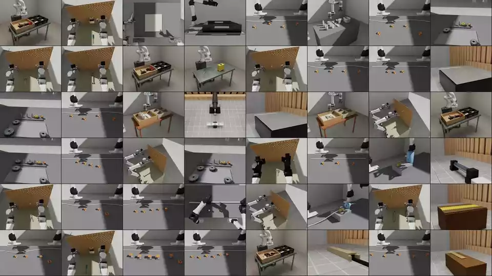

#  RoboSimStudio

[Tech report](https://arxiv.org/abs/2610.18835) | [Project Page](https://robosimstudio.github.io/) | [Examples](examples/README.md)

RoboSimStudio is an open, interactive simulation toolkit for rebuilding real
robot manipulation tasks in simulation, by hand or with a coding agent.

<p align="center">
  
</p>

---
### News
- **[2026/10/21]** 🔥 We have released many-demo collection with physics on the CPU and GL rendering: 500 demos in 4.2 min on one GPU. 
- **[2026/10/20]** 🔥 We have added fifteen kinds of material, among them rope, knots, paper, bags, brushes, tape, cutting, granular, liquid, dough and water, each with an example at [**Materials**](examples/).
- **[2026/10/18]** 🔥 RoboSimStudio runs on CPU-only machines. Get started [**Here**](examples/install.md).
- **[2026/10/14]** 🔥 RoboSimStudio has been released!

## Quick start

We provide an [installation guide](https://github.com/robosimstudio/robosimstudio/blob/main/examples/install.md) and comprehensive examples in [`examples/`](https://github.com/robosimstudio/robosimstudio/tree/main/examples) to help you get started quickly. Alternatively, you can use a coding agent such as Codex or Claude Code to create a simulation environment by simply providing the following prompt:

```
Set up environment for https://github.com/robosimstudio/robosimstudio
and create a simulation environment for [Your task instruction] with Robot [Robot URDF]
based on the video at [Your Video Path] / demonstration at [Robot Demonstration].
```

> [!TIP]
> 1. RoboSimStudio supports human video, ego-centric video, robot video and teleoperation.
> 2. Use **Codex Astra** for better scene construction.
> 3. Use **Claude Code** for better robot motion.
> 4. Keep a **human in the loop** to sometimes remind the agent to reconstruct the physics and geometry.

## Acknowledgements

RoboSimStudio is hugely inspired and built on [Newton](https://github.com/newton-physics/newton),
[Warp](https://github.com/NVIDIA/warp),
[MuJoCo Warp](https://github.com/google-deepmind/mujoco_warp),
[SuperDex](https://github.com/facebookresearch/project_superdex).
[viser](https://github.com/viser-project/viser), 
[Isaac Lab](https://github.com/isaac-sim/IsaacLab),
[PyRoKi](https://github.com/chungmin99/pyroki),
[Genesis](https://github.com/Genesis-Embodied-AI/Genesis).
Robot models come from
[i2rt](https://github.com/i2rt-robotics/i2rt) and
[robosuite](https://github.com/ARISE-Initiative/robosuite); see `NOTICE`.
Thanks to their authors.

## Citation

```bibtex
@misc{robosimstudio2026,
  title         = {RoboSimStudio: An Interactive Toolkit for Rapid Real2Sim of Robot Manipulation Tasks},
  author        = {Chen, Kaiyuan and Xie, Shuangyu and Yoo, Uksang and Zhu, Xinyue and Magner, Cael and Zhu, Alvin and Kim, Daehwa and Heiden, Eric and Coumans, Erwin and Macklin, Miles and Huang, Spencer and Goldberg, Ken},
  year          = {2026},
  eprint        = {2610.18835},
  archivePrefix = {arXiv},
  url           = {https://arxiv.org/abs/2610.18835},
}
```

## License

RoboSimStudio is released under the [Apache License 2.0](LICENSE).
