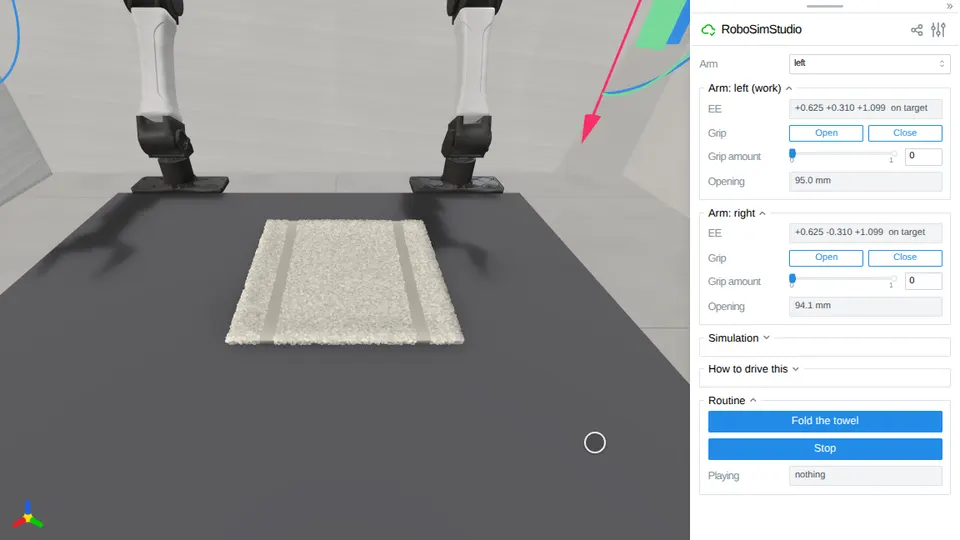

# Fold the towel



Two YAM arms fold a terry towel in half on a bench, from their home pose, and
nothing holds the towel but the left hand's fingers. The routine plays on the
studio page from a **Run** button and drives the two arm panels the way a
person does, so the gizmos move and the arms follow them through their IK.

```bash
uv run demo/fold_the_towel/fold_the_towel.py
```

Open the page, then press **Fold the towel** in the **Routine** folder. **Stop**
ends it where it is, **Reset** puts the towel back flat, and either arm can be
driven by hand at any time.

## The scene

The towel, the bench and the physics are the `cloth_fold` suite's `towel_half`
task:

- a 30 cm square of 5 mm terry, 500 g/m², built as a slab of 30 x 30 cells and
  settled flat from 1 mm over `bench_0728`, at `(-0.05, +0.06)` in the bench's
  work-surface frame, which is the left arm's reach band;
- MuJoCo for the arms and VBD for the cloth at 60 Hz x 10 substeps, coupled one
  way, with full-surface contact and a 10 mm soft-contact margin.

One change: the towel's core is the softened terry of the live towel page
(3 kPa, bending on the faces). With the measured core (100 kPa) the towel lifts
as a plate, and the pinch had lost 44% of the edge by the top of the arc and
all of it by the place: fold score 0.52.

The fold is scored with the suite's own goal, through the library's measures:
the span across the fold at most 0.6 of the settled span (`fold_extent`), a
fold score of at least 0.85 (`fold_score`, SoftGym's ClothFold with the drag
term), and the towel still (95th-percentile speed under 0.02 m/s) and released.

## The routine

`routine(sim, session)` is a generator, one yield per control step, built from
`reach`, `grip` and `wait` in `robosimstudio_studio.routine`:

1. **Both hands to their marks.** The right hand, shut, goes over the near half
   at `(0.0, -0.04)` and presses through the towel to the bench. The left hand
   turns tool-down and goes over the far edge at `x = -0.08`, its jaws across
   the edge.
2. **Fingertips on the bench, squeeze, rise.** The left fingertips go down onto
   the bench 6 mm in from the edge, so the outer pad is on bare bench and the
   inner pad on the towel. The hand squeezes to 0.95 (pads 3.5 mm apart) and
   rises 3 mm while it squeezes. The jaws gather the edge's whole thickness, and
   the bench's friction no longer holds them open.
3. **Carry.** Over the crease in a low arc, its top 6 cm over the place, in
   5 s, and down 12.5 mm short of the edge's mirror (2.5 slab thicknesses, the
   suite's slack). The press lifts away at 90% of the carry, before the flap
   lands on it.
4. **Let go.** The left hand opens, backs off over the fold and up, and both
   hands go home. Five still seconds, and the routine prints the fold's
   measures.

The routine runs 18.4 s of simulated time.

## What holds the towel

Friction, between the pads and the cloth: VBD's contact between the cloth and
the YAM's pad boxes, under one-way coupling. Nothing is pinned, latched or made
weightless, and the fingers keep colliding with the cloth throughout. The
library's `rss.sheet(held_by=...)` latch, which this demo used to start from, is
not used.

Before this demo could work, the one-way coupler had to hand VBD the arm's
previous poses as well as its new ones. VBD's friction is the particle's slip
against how far the pad under it moved, and it had been given the new pose
twice, so every finger stood still to friction. A pinch then kept 0 of the 15
particles it closed on through a 100 mm lift; with the motion it keeps all 15.

## Measured

Six runs of the final routine, three of them through
`tests/test_demo_fold_the_towel.py`:

| | fold extent (≤ 0.6) | fold score (≥ 0.85) | near half moved | settle speed | pinched | held at the top of the arc |
| --- | --- | --- | --- | --- | --- | --- |
| test run 1 | 0.537 | 0.867 | 4.2 mm | 0.0052 m/s | 29 | 100% |
| test run 2 | 0.520 | 0.884 | 5.0 mm | 0.0038 m/s | 32 | 100% |
| test run 3 | 0.538 | 0.863 | 4.1 mm | 0.0041 m/s | 29 | 100% |
| run 4 | 0.514 | 0.884 | 4.8 mm | 0.0040 m/s | 31 | 100% |
| run 5 | 0.518 | 0.885 | 4.9 mm | 0.0027 m/s | 32 | 100% |
| run 6 | 0.539 | 0.851 | 4.4 mm | 0.0025 m/s | 29 | 100% |

In every run the pinched edge rose 74 mm at the top of the arc. In the three
test runs the near half lifted at most 12.6 mm and the fingertips stayed 0.5 mm
above the bench.

## Limits

- **The margin over the gate is small.** The score spreads by 0.03 run to run,
  and small changes move it more: pinching 5 mm further along the edge
  (`x = -0.085`) scored 0.81 three times, and a 6 s carry 0.70-0.72. The suite
  saw the same with its latch: one configuration scored 0.657 to 0.898 over
  five runs.
- **The squeeze drags the towel.** The inner pad sweeps 47 mm of towel as the
  jaws close, and the near edge's free corner moves 26-28 mm. A hand half shut
  before it came down swept less and pinched nothing.
- **The pinch wants the fingertips on the bench.** With them 1.5 mm above it,
  the jaws pinched 5-7 particles and lifted nothing in 3 of 4 runs.
- **One hand carries.** Only the left arm reaches both the far edge and its
  mirror with the tool down, and only just: joint 4 is at -1.47 rad at the
  place, against its -1.57 stop. The right arm cannot reach the far edge (50 mm short), so the two
  hands cannot each take a corner of it.
- Under one-way coupling the arm feels nothing from the cloth.

Test: `python -m unittest tests.test_demo_fold_the_towel` (medium tier, about
90 s on one GPU).
