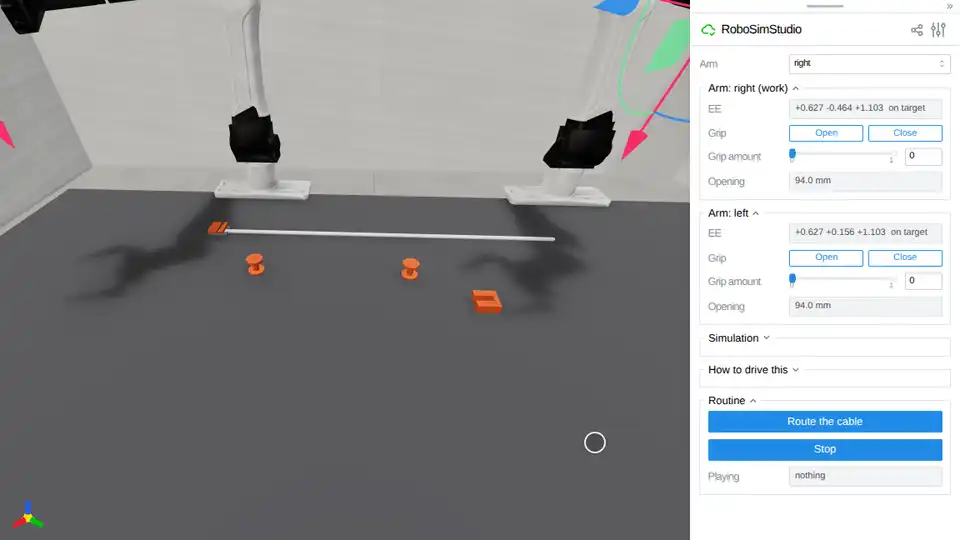

# Route the cable



Two YAM arms route a cable from its anchor, past two spools and into a port,
holding it by friction alone. Open the page and press **Run** under *Routine*,
or do the same job by hand with the gizmos and the **Grip** buttons.

```bash
uv run demo/route_the_cable/route_the_cable.py
```

## The board

[`board.py`](board.py) is VABAR's easy cable-routing tier
(`cable_route/port_easy`) at the reference's measured numbers, on `bench_075`:

- a 600 mm cable of 50 capsules, 7 mm across, welded under an anchor bracket at
  its first end (`RodSpec(anchors=("start",))`) and lying straight along +y;
- two ManipulationNet F1 spools 240 mm apart on the line 75 mm toward the robot
  from the bench's middle: the cable must pass the first on the robot's side and
  the second on the far side;
- a port 61 mm out from the second spool and 100 mm past it: a 10 mm channel
  between two walls 12.5 mm tall, open on top, with a stop at the back.

It differs from the reference in two places. The spools are three cylinders at
the F1's measured radii (a 4.75 mm shaft between 12.5 mm flanges, 23.5 mm tall)
rather than its mesh. And the port faces the run: its channel runs along y,
where the reference turns it to face the robot. A YAM wrist rolls 120 degrees
either way, and from the grasps this board leaves the roll ran out before a
held end could be turned 90 degrees into a channel facing the robot (measured on
both arms, both rolls).

**Routed** is the reference's goal: at least two capsules of the fifty in each
spool's seat (3 to 45 mm off its axis on its side, 35 mm either way along the
line), at least three in the port's 90 mm box with the free end among them, both
hands more than 50 mm from the cable, and the cable at rest (no capsule faster
than 50 mm/s). `board.done(sim, hands)` measures it.

## The routine

`routine(sim, session)` is what a person does with the gizmos, four times over:
drag a hand down onto the cable, **Close**, carry, set it down, **Open**. It
drives the arm panels and nothing else, so the gizmos move on the page as they
would under a mouse, and nothing latches or pins the cable.

1. The right hand takes the cable 165 mm from its anchor and lays it beside the
   first spool, on the robot's side.
2. It takes it at 280 mm and lays it across the spools' line, between them.
3. It takes it at 440 mm, lifts it clear of the second spool's rim (65 mm up)
   and lays it round that spool's far side. Then it goes home.
4. The left hand takes the cable 35 mm from its free end, brings the end to the
   port's mouth, turns and slides until the cable ahead of the fingers points
   down the channel (read from the cable's own shape, twice), holds the end
   over the channel and lowers it in. Then it goes home.

Every grasp pinches the cable lying on the bench: the tool centre is sent 11.5
mm over it, so the fingertips stop on the bench with the whole 7 mm cable
between the pads, and it is carried 30 mm up at 50 mm/s.

## What holds it

- `CollisionSpec(contact_matching="sticky")` and VBD's `rigid_contact_history`:
  each contact keeps its anchor from step to step, which is static friction.
  Without them a pinched capsule crept through the pads at 15 mm/s and fell out
  of a 0.15 m/s lift (on the 22 mm cable of `examples/10_rope/00_cable.py`).
  The reference's own arrangement (`cable_coupled_960hz@v1`: proxies at 20x
  mass, 40 VBD iterations) never moved the cable in a pinch and drag here,
  three runs of three, at a quarter of the speed.
- `RodSpec(scene_friction=True)`: the pads take the rod's `mu_gripper` (60),
  the bench its `mu_surface` (0.02); `allow_grasp_latch=False`.
- `rss.robot("yam_i2rt", gripper=rss.ActuationSpec(target_ke=6000, target_kd=120))`:
  a cable dragged across the jaws pries them open. At the i2rt fingers' own
  600 N/m it slid out of 3 drags of 7; at 2000 N/m the carry round the second
  spool pried them 5 mm apart and lost the cable in 3 runs of 26.

## Measured

[`tests/test_demo_route_the_cable.py`](../../tests/test_demo_route_the_cable.py)
runs the routine headless from home to the end, through the page's own Run
button and arm panels, and holds it to the goal above, to 12 mm (one capsule)
of slip per grasp, and to a cable that never sinks into the bench or a spool.
Three runs, on one NVIDIA RTX PRO 6000 Blackwell:

| Run | Seat 1 | Seat 2 | Port | End in port | Slip per grasp [mm] | Routed |
| --- | --- | --- | --- | --- | --- | --- |
| 1 | 5 capsules | 5 | 7 | yes | 5.7, 2.9, 4.2, 7.9 | yes |
| 2 | 5 | 5 | 9 | yes | 7.0, 3.9, 10.8, 6.7 | yes |
| 3 | 5 | 6 | 10 | yes | 2.2, 2.6, 4.5, 8.6 | yes |

The routine is 41.8 s of simulated time (2,505 control steps at 60 Hz) and ran
in 88 s, about 28 steps a second. In sixteen more runs it routed the cable every
time, with no grasp slipping more than 9.1 mm.
