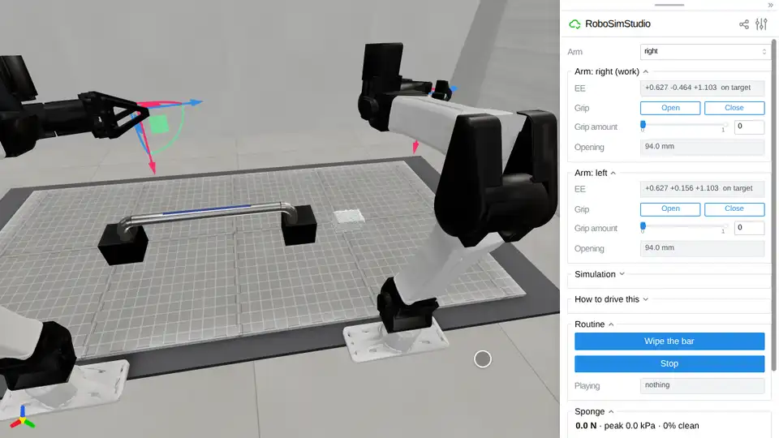

# Wipe the bar



The twin of a real cell, and the whole job in it: two YAMs at their home pose,
a kitchen sponge lying on a gridded foam mat, and a chrome grab bar bolted into
two black blocks with a blue marker stripe drawn along its crown. Press **Wipe
the bar** on the page and the arms do what the clip shows: the left hand
steadies the bar at its far elbow, the right takes the sponge off the mat,
presses it onto the bar and strokes the marker off, puts the sponge back where
it lay, and both arms go home.

**The sponge is held by the jaws alone.** Nothing pins the foam to the pads, and
that is the open problem: under the press and the drag of the bar the sponge
slides in the YAM's jaws, so the job is not finished yet. The numbers are below.

```bash
uv run --extra superdex python demo/wipe_the_bar/wipe_the_bar.py
```

The first run builds the YAM's fingertip collision and compiles the kernels, so
give it a minute. Needs the `[superdex]` extra (Python 3.12) and a GPU.

## The files

| | |
| --- | --- |
| [`wipe_the_bar.py`](wipe_the_bar.py) | builds the scene and opens the page, with the press readout, a contact map and the Run button |
| [`bar.py`](bar.py) | the scene: the layout measured off the clip, the welded bar, the stripe that wears off, the physics |
| [`routine.py`](routine.py) | the job, as a generator the page plays one control step at a time |

The layout is the `surface_prep` task's, measured off the *Surface Preparing*
clip against the mat's 25 mm grid: a 25 mm tube with a 340 mm straight run on
two 32 mm elbows, its legs 50 mm into 76 x 80 x 70 mm blocks on a 10 mm mat; the
stripe is the middle 200 mm of the crown and 9 degrees wide (243 cells of
2.5 mm); the sponge is 50 x 75 x 30 mm, 70 mm past the near block's outer face.
The stripe wears by Preston's law, `ink' = -k_p * pressure * sliding speed`, fed
by SuperDex's own contact samples on the bar, with no wear under 300 Pa. Its
**cleaned fraction** -- the share of cells with a tenth of their ink or less --
is the job's measure.

## What the routine does

Every move is a drag of an arm's gizmo and every grip a press of its Grip
control, so the page shows what a person would do by hand:

1. **Steady.** The left gizmo goes 50 mm over the far elbow, down until the jaws
   straddle the tube 4 mm over its axis, and the jaws close to 29 mm: a hand
   resting on the bar, not clamping it.
2. **Pick.** The right gizmo goes 100 mm over the sponge, top-down with the jaws
   across its 50 mm side, down until the pads are on its middle, and **Close**:
   the jaws squeeze it from 50 mm to 45.5 mm at their 8 N cap.
3. **Carry.** Up 100 mm, over the near block at the crossing height leaning 35
   degrees along the bar, then over the near end of the stripe.
4. **Wipe.** Down a millimetre at a time until the stripe reads 1.5 N, then a
   stroke toward the far end at 60 mm/s, the hand following the press up and down
   and staying centred on the crown; up, back, and again, four times or until the
   stripe is 96 % clean. Strokes go one way only, the low edge of the leaning
   sponge trailing.
5. **Put back.** Back over the near block, down onto the spot the sponge came
   from, **Open**, up; the left hand opens and lifts; both gizmos go home.

A take is 49-59 s of simulated time.

## Measured

Three takes of the test (`RSS_WIPE_THE_BAR=1 python -m unittest
tests.test_demo_wipe_the_bar`), 2026-10-13, one RTX PRO 6000 Blackwell:

| take | cleaned | peak press | sponge slid in the jaws | sponge put back | arms home |
| --- | --- | --- | --- | --- | --- |
| 1 | 0.761 | 10.3 N | 69 mm | 49 mm from its spot | yes |
| 2 | 0.724 | 11.4 N | 226 mm, out of the jaws before stroke 4 | no | yes |
| 3 | 0.687 | 12.4 N | 218 mm, out of the jaws before stroke 3 | no | yes |

What does work, in every take: the pick (the sponge comes off the mat in the
jaws, 45.5-45.7 mm apart, and is carried to the bar sliding 3-9 mm), the press
(seated at 1.6-2.0 N, peaks of 111-116 kPa on the tube), the first stroke
(0.54-0.65 of the stripe clean), and both arms back at home (0.5 mm and 0.3 mm
off in the takes that logged it).

What does not: on every stroke the foam under the pads slides 10-20 mm in the
hand, back along the bar and up toward the palm, and the slips add up until the
sponge leaves the jaws or is put down 49 mm from where it was. The pads report
8-9 N of grip each and the bar 0.4-0.6 N of drag, yet the foam slides at
1.5-3 mm/s, the pads' tangential force at 0.84-0.88 of their normal force (the
friction coefficient between them and the foam is 0.95).

Tried, over 30 more takes while tuning, none of which held the slip under 10 mm:

| lever | what it did |
| --- | --- |
| the sponge's `friction_falloff`, 1 and 0.1 mm/s | the same 10-20 mm a stroke at both |
| grip cap 12 N | the sponge left the jaws sooner |
| press steered to 1.5, 2, 3 and 4 N | below 2 N the press reads 0.6-1 N through a stroke and still slides; at 4 N it peaks at 9-12 N |
| lean 25 degrees | lost before stroke 4; the far seat is 3 mm out of reach |
| strokes both ways | the stroke back dug the low edge in, 0.6 N to 7.6 N in two thirds of a second, and turned the sponge out |
| stroke speed 120 mm/s | cleaned up to 0.95 in one take, the sponge lost in all four |
| bar friction 0.2 (from 0.6) | cleaned 0.82 and 0.94, slid 77 and 109 mm |
| sponge friction 2.0 (from 0.9) | lost |
| soft foam (the clip's) | the jaws closed through it on the pick |

**Not the fingertips' decomposition.** The YAM's tips are 48 and 52 convex
pieces each, and SuperDex mirrors every piece as a collider of its own, where
the Panda's pads are one box each. Mirrored instead as one convex hull of each
tip's last 30-60 mm, the jaws lift and hold the sponge as they do now (3 s of
hold: 0.11-0.14 mm of slip against 0.10 mm; a 10 s idle: 0.11-0.13 mm against
0.10 mm), and three wipes still lost it: cleaned 0.65, 0.81 and 0.71, the foam
sliding 680, 192 and 599 mm in the jaws. One hull of a whole tip is worse: it
takes in the tip's L-shaped root, and the jaws stopped 55.7 mm apart on the 50 mm
sponge and lifted it 10 mm.

## Tests

```bash
RSS_WIPE_THE_BAR=1 uv run python -m unittest tests.test_demo_wipe_the_bar   # slow: the whole job, through the Run button
```

Skipped without the variable, because three of its six assertions -- the
stripe at least 0.9 clean, the sponge back within 20 mm of its spot, and under
10 mm of slip in the jaws -- fail today.
