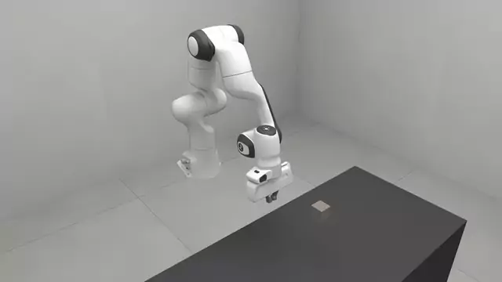
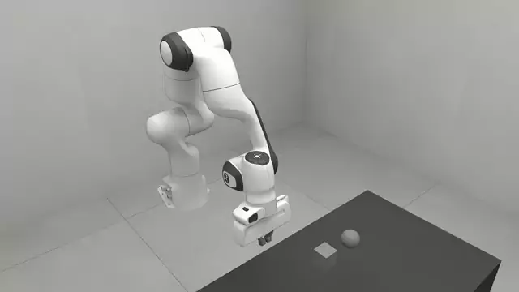

# Getting started

How to assemble a scene, build it, step it and read it back.

<!-- examples:start: written by scripts/example_readmes.py from each script's docstring -->

## Hello world



The smallest RoboSimStudio program: a bench, a cube released above it and a robot arm.

`build()` turns the scene into a simulation, 150 steps let the cube land, and
the last line opens the studio in a browser: click the cube to drag it, or drag
the gizmo on the hand to drive the arm.

**Key features:**

* `rss.Scene` and `rss.Scene.add` to declare what stands where
* `rss.box` and `rss.robot` for a free body and a registered robot
* `rss.Sim.run` to step and `rss.view` to open the browser studio

```bash
uv run examples/00_getting_started/00_hello_world.py
```

Source: [`00_hello_world.py`](00_hello_world.py)

## Core concepts



A scene you declare, a sim that runs it, and a ref on each thing you added.

A `rss.Scene` is a list of specs in a named place and simulates
nothing. `rss.Scene.build` compiles it into a
`rss.Sim`, which owns the state and steps it. Each `add`
returns a `rss.Ref`, a name that reads the live state.

Every `at=` is measured from the middle of the place's work surface, so the
same two specs are built here on a bench and again on a bare floor.

**Key features:**

* `rss.Scene.add` returning a `rss.Ref` for each thing
* The work-surface frame: one `at=` in two places, `"bench_075"` and `"void"`
* `rss.Sim.run`, `rss.Sim.sync` and `rss.Sim.reset`
* `sim["cube"]` and `rss.Sim.names` to find a thing by its name
* `rss.Ref.position`, read from the simulation each time it is asked

```bash
uv run examples/00_getting_started/01_core_concepts.py
```

Source: [`01_core_concepts.py`](01_core_concepts.py)

<!-- examples:end -->

## Scene, Sim and Ref

A scene is three objects:

- `Scene` holds a cell, the physics settings and the
  things you add.
- `Sim` is what `scene.build()` returns. It steps the
  scene.
- `Ref` is what `scene.add()` returns. It reads one thing.

```python
import robosimstudio as rss

scene = rss.Scene(cell="bench_075")
cube = scene.add(rss.box(name="cube", half=(0.025,) * 3, at=(0, 0, 0.2)))
scene.add(rss.robot("panda"))

sim = scene.build()
sim.run(150).sync()     # 150 control steps, then wait for the GPU
print(cube.position)    # (0.600, 0.000, 0.775)
```

The cube starts 200 mm above the middle of a 750 mm bench and comes to rest on
it.

## Constructors

A constructor is a function that returns a spec. Pass the spec to
`Scene.add()`.

| Constructor | Makes | Arguments that matter |
| --- | --- | --- |
| `rss.box` | A rigid box | `half` (half-extents), `at` |
| `rss.sphere` | A rigid ball | `radius`, `at` |
| `rss.capsule` | A rigid capsule along its own z | `radius`, `half_height`, `at` |
| `rss.cylinder` | A rigid cylinder along its own z | `radius`, `half_height`, `at` |
| `rss.body` | A rigid body from a mesh file | `asset` (a path), `scale`, `at` |
| `rss.slab` | A fixed box: a wall, a shelf | `half`, `at` |
| `rss.post` | A fixed upright cylinder | `radius`, `half_height`, `at` |
| `rss.sheet` | Cloth | `size`, `cells`, `at`, `material` |
| `rss.sponge` | A soft body (FEM) | `size`, `cells`, `at`, `material` |
| `rss.robot` | A robot | a registered name, `at` |

Notes:

- Every thing has a `name`. Names are unique in a scene, and `scene.add` raises
  on a duplicate.
- The rigid constructors also take `mass`, `friction`, `color` and `quat`.
- `rss.body` reads `.obj`, `.stl`, `.ply`, `.glb`, `.gltf` and `.dae` files.
- A scene holds one robot. A two-arm pair such as `yam_bimanual` is one robot.
- A scene needs at least one thing that moves, or `build()` raises.

The registered robots are `panda`, `panda_robotiq`, `panda_robotiq_roll`,
`yam_bimanual`, `yam_i2rt` and `yam_i2rt_arena_narrow`.

## Placing things

`at` is in metres, in the cell's work-surface frame. The origin is the middle of
the work surface, at its top, and +z is up. `at=(0, 0, 0.2)` is 200 mm above the
middle of the bench, whichever bench the scene uses.

What `at` places depends on the kind:

- Rigid bodies, `slab` and `post`: the centre.
- `sheet`: the origin corner. Subtract half the size to centre the sheet.
- `sponge`: the centre of the bottom face.
- `robot`: the base. Leave `at` out and a registered robot stands at its own
  mount, at the edge of the work surface.

`cell` chooses the place:

| Cell | Work surface |
| --- | --- |
| `void` | The floor |
| `bench_075` | A bench 750 mm high, 595 mm by 1300 mm |
| `bench_0728` | A bench 728 mm high, 600 mm by 800 mm |

`rss.list_cells()` lists every cell. See [Frames and units](../live/REFERENCE.md#frames-and-units) for frames,
units and quaternion order.

## Stepping

```python
sim.run(60)        # 60 more control steps, with no command to the robot
sim.sync()         # wait for the GPU before reading
print(sim.time)    # 3.5 (seconds simulated since the build)
```

- A control step is 1/60 s by default. See [Physics and engines](../PHYSICS.md) to change it.
- The two scripts here stage `physics=rss.MUJOCO_500HZ`, which steps at 50 Hz and
  puts the arm and the cube in one engine, so the hand can close on the cube and
  lift it. Under the default a hand can push a free body but not pinch one.
- `sim.run` returns the sim, so `sim.run(60).sync()` chains.
- `sim.step(action, mode="joint_position")` advances one control step with a
  command for the robot.

## Reading state

```python
print(cube.position)           # (x, y, z) in the world frame
print(cube.pose)               # (x, y, z, qx, qy, qz, qw)
print(cube.velocity)           # (vx, vy, vz, wx, wy, wz)
print(sim["cube"].position)    # the same Ref, looked up by name
print(sim.names())             # ['cube', 'table']

state = sim.read()             # every pose in one read
print(state.position("cube"))
```

- A `Ref` caches nothing. Each read goes to the live state.
- Reads are in the world frame. On `bench_075` the work-surface origin is at
  world `(0.6, 0, 0.75)`.
- Cloth and soft bodies have no pose. Read their points with `ref.particle_q`,
  an `(n, 3)` array.

## Resetting

```python
sim.reset()             # back to the start state
print(cube.position)    # (0.600, 0.000, 0.950)
```

Building again is the other way to start over. `scene.build()` returns a new
`Sim`, and every `Ref` from that scene then reads the new one.

## Looking at it

```python
rss.view(sim)    # open the studio in a browser and drag things
```

`rss.view` serves a page and runs the scene until
you stop it. See [Studio](../05_studio/README.md).


*Click the cube and it is held; drag its handle; let go and it falls. Reset puts it back.*


**See also:**

- the docstrings of `rss.Scene`, `Sim` and `Ref`, and of each constructor, for
  every argument (`help(rss.box)`)
- [Physics and engines](../PHYSICS.md) for engines, rates and coupling
- [`00_hello_world.py`](00_hello_world.py) and
  [`01_rigid/00_drag_things.py`](../01_rigid/00_drag_things.py)
