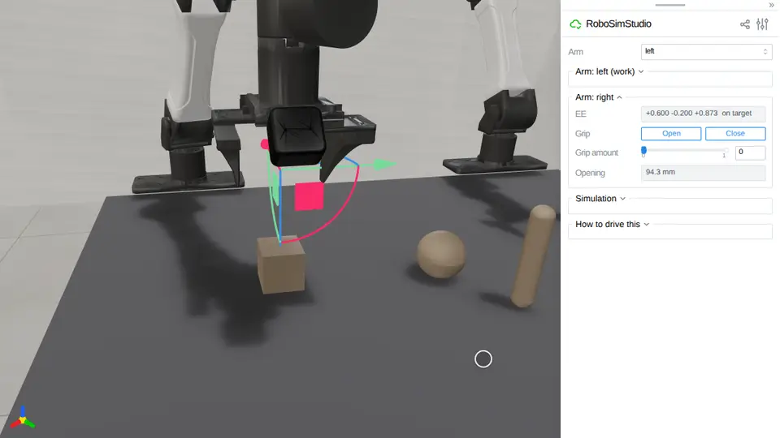

# Rigid bodies

Boxes, spheres, capsules and bodies loaded from a file.

<!-- examples:start: written by scripts/example_readmes.py from each script's docstring -->

## Drag rigid bodies



A box, a ball, a capsule and two arms on the floor: click any of them and drag it.

A click puts a handle on a body, and the body stays fully dynamic under it, so
you can push one shape with another or tug on something a hand is holding. Drag
an arm's gizmo to move it through IK. Poses are in the work-surface frame; in
the `void` cell that surface is the floor, so `z` is a height above ground.

**Key features:**

* `rss.Scene` and `rss.Scene.add` to put things in a place
* `rss.box`, `rss.sphere` and `rss.capsule` for shapes with no asset file
* `rss.robot` for the arms
* `rss.Scene.build` for a running sim
* `rss.view` to open the studio page on it

```bash
uv run examples/01_rigid/00_drag_things.py
```

Source: [`00_drag_things.py`](00_drag_things.py)

<!-- examples:end -->
