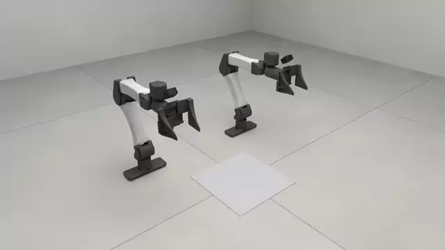
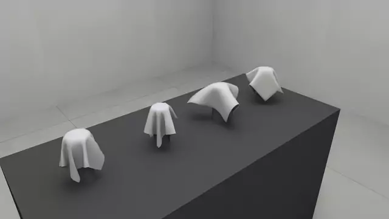
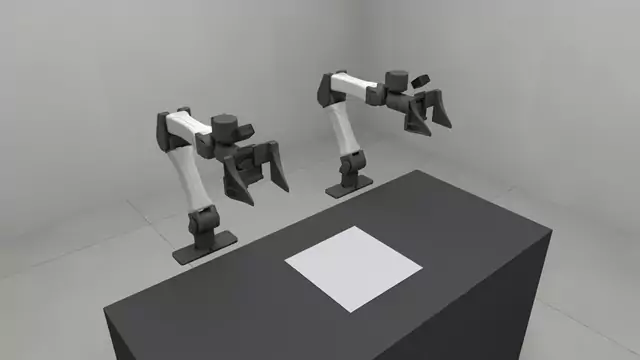
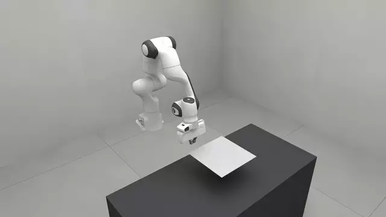

# Cloth

Sheets: a pinch, fabrics, engines, and a cloth of your own. How a sheet is
built, section by section: [`cloth.py`](cloth.py), the implementation
`rss.sheet` builds.

A gripper holds a sheet by friction alone, under one-way coupling with
full-surface contact: `00_towel.py` lifts a towel by its edge, and
`04_your_own_cloth.py` lifts a draped hem. On a flat sheet the fingertips must
reach the bench, or the pads close over the edge rather than around it. Under
one-way coupling the arm feels nothing from the cloth, so a shut hand closes
right through it.


*A click on the cloth pins a patch to a handle. Lift it, carry it, let go.*


*Two holds on two corners with Move together on: one drag carries the sheet flat.*

<!-- examples:start: written by scripts/example_readmes.py from each script's docstring -->

## Pinch a towel



A terry towel on a bench, its edge under an open hand: drag the hand down onto the edge, close it and lift.

The right hand starts pointing down over the towel's near edge, its jaws across it. Drag
its gizmo down until the fingertips reach the bench, press **Close**, and drag it up: the
pads gather the edge and hold it by friction alone, and the towel hangs from the hand. That
needs one-way coupling and full-surface contact; the default physics lets a hand push a
sheet but not pinch one. A click on the cloth pins a patch to a handle instead, and two
handles with `Move together` carry the sheet by two corners.

**Key features:**

* `rss.sheet` for a rectangular cloth, placed by its corner
* `rss.materials.TERRY_TOWELLING`, one of the measured fabrics
* `rss.replace` on `rss.GENERIC` with `rss.coupler` and `rss.CollisionSpec.full_surface_contact`, for a pinch that holds
* `rss.ArmSpec` `home_q` for a hand that starts over the edge

```bash
uv run examples/02_cloth/00_towel.py
```

Source: [`00_towel.py`](00_towel.py)

## Fabrics



The same square of cloth in four shipped fabrics, each draped over its own post.

What a sheet is made of is a `rss.ClothMaterialSpec`: stretch
and bending stiffness, weight per area, thickness. `rss.materials` holds the
fabrics that ship. Along the bench (+y) the posts carry a jersey tee, packing
tape, sweatshirt fleece and terry towelling, from limp to stiff.

In the studio open the **Material** folder: `Cloth` picks one of the four and
the sliders under it change that sheet while it hangs.

**Key features:**

* `rss.sheet` with `material=` to say what a sheet is made of
* `rss.materials`, the shipped fabrics, each a `rss.ClothMaterialSpec`
* `rss.post` for something welded in place to drape over
* `rss.CollisionSpec` with `full_surface_contact` for contact over faces, not only vertices
* `panels=` on `rss.view` to put the live material sliders on the page

```bash
uv run examples/02_cloth/01_fabrics.py
```

Source: [`01_fabrics.py`](01_fabrics.py)

## Cloth on another engine



The same sheet on Newton, SuperDex or Genesis: change one string at the top of `main()` and run it again.

The spec does not change between runs. Only the entry that says which solver
serves cloth does, and the arm stays on MuJoCo every time. The script prints
the island table, which names the solver each thing landed on. `newton` runs
on a base install; the other two are optional extras, `[superdex]`
(Python 3.12) and `[genesis]`.

**Key features:**

* `rss.backend` to name a solver
* `rss.replace` on `rss.GENERIC` to route cloth to it
* `rss.sheet`, unchanged whichever engine runs it
* `sim.pipeline.program.summary()` to print what was built

```bash
uv run examples/02_cloth/02_engines.py
```

Source: [`02_engines.py`](02_engines.py)

## Cloth on Genesis

A sheet simulated by Genesis beside a Newton arm: drag the wrist gizmo down onto the cloth.

One entry in the physics arrangement routes cloth to Genesis's IPC solver. The
arm stays on MuJoCo, and the contact reaction flows back onto the hand.
Needs the `[genesis]` extra (Linux or Windows x86 with an NVIDIA GPU).

**Key features:**

* `rss.backend` with `"genesis"` to route cloth to a foreign engine
* `GENERIC`, the default arrangement the entry replaces
* `rss.sheet`, the same spec the default solver takes
* `rss.view` to drive the arm from the page

```bash
uv run --extra genesis examples/02_cloth/03_genesis.py
```

Source: [`03_genesis.py`](03_genesis.py)

## Your own cloth



A second implementation of cloth, written in this file and draped over a ball beside a Panda.

`MyCloth` puts a particle on every vertex of a grid and two triangles in every
cell through Newton's builder; the library's particle storage does the rest,
from the handle the studio pins to the state a reset returns to. The stock
`rss.ClothSpec` describes the sheet, and its `entity=` field
asks for this class instead of the shipped one. In the studio, click the sheet
to pin a patch and drag it, or drag the hand straight down onto the hem below it,
set **Grip amount** to 0.95 and lift: the fingers hold the hem by friction. Not
**Close**: shut, the pads squeeze the sheet out from between them.
Limits: a flat grid only; a fabric's thickness and contact numbers are not read.

**Key features:**

* `rss.register_entity` to register an implementation under a name of its own
* `rss.Entity` and its `build`, where particles and triangles go into Newton's builder
* `ParticleMixin` for bind, handle, reset and reading, shared by every kind made of particles
* `rss.ClothSpec` with `entity="my_cloth"` to say "use mine"
* `rss.coupler` and `rss.CollisionSpec` `force_sdf` for fingers that can hold it

```bash
uv run examples/02_cloth/04_your_own_cloth.py
```

Source: [`04_your_own_cloth.py`](04_your_own_cloth.py)

<!-- examples:end -->
