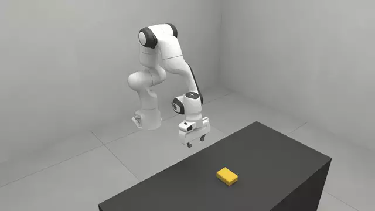
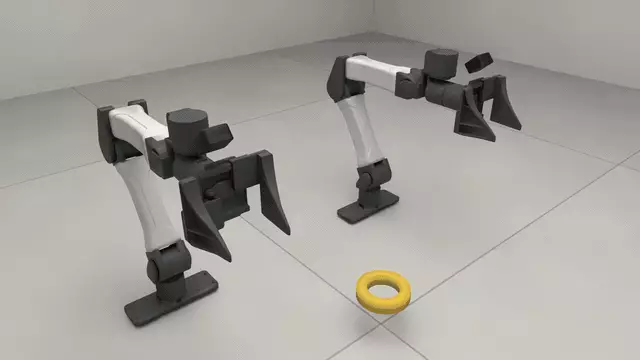
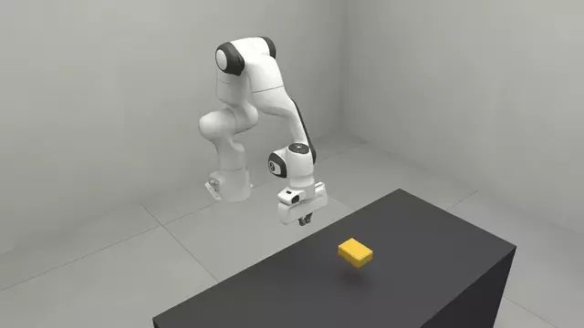

# Soft bodies

Volumetric soft bodies beside a Newton arm, and one of your own. How a sponge
is built, section by section: [`soft.py`](soft.py), the implementation
`rss.sponge` builds.


*The hand driven down onto a sponge: it squashes under the jaw and recovers.*

<!-- examples:start: written by scripts/example_readmes.py from each script's docstring -->

## Press a sponge



A foam sponge under a Panda arm: drag the wrist gizmo down and the top face gives way under the fingertips.

The arm is Newton's and the sponge is a volumetric FEM body that SuperDex steps.
The default arrangement already routes soft bodies there, so the script says
nothing about engines. Needs the `[superdex]` extra (Python 3.12).

**Key features:**

* `rss.sponge` for a soft block
* `rss.robot` with `"panda"` for a single arm
* `rss.Scene` with `cell="bench_075"` for a bench to stand them on
* `rss.view` to drive the arm from the page

```bash
uv run --extra superdex examples/03_soft/00_sponge.py
```

Source: [`00_sponge.py`](00_sponge.py)

## Soft body from a file



A rubber O-ring read out of a tetrahedral mesh file and dropped between two arms: click it and drag.

The script writes the mesh itself so you can see the format: an `.npz` holding
`vertices` and `tets`. Anything `meshio` reads that has tetrahedra in it
works too, so point `AssetSpec(path=...)` at your own file and delete the
writer. Wind every tetrahedron so its rest volume is positive: Newton drops the
others without a word. The ring runs on Newton's VBD here, on a base install.

**Key features:**

* `rss.SoftSpec` with `rss.SoftSpec.asset` for a body from a file
* `rss.AssetSpec` to name the file
* `rss.replace` on `rss.GENERIC` to keep soft bodies on Newton
* `rss.view` to take hold of the result

```bash
uv run examples/03_soft/01_tet_mesh.py
```

Source: [`01_tet_mesh.py`](01_tet_mesh.py)

## Your own soft body



A second implementation of a soft body, written in this file: a block of tetrahedra dropped onto the bench beside a Panda.

`MySoft` cuts a lattice into six tetrahedra per cell and hands them to
Newton's builder; the library's particle storage does the rest, so a click in
the studio pins a patch you can drag. The stock `rss.SoftSpec`
describes the block, and its `entity=` field asks for this class. Newton's own
VBD solver steps it and no extra is needed: the one physics line drops the entry
that sends soft bodies to SuperDex. Limits: on VBD the hand passes into the
block rather than pressing it (30 mm of travel dents the top 3 mm);
`00_sponge.py` is the press, on SuperDex.

**Key features:**

* `rss.register_entity` to register an implementation under a name of its own
* `rss.Entity` and its `build`, where the tetrahedra go into Newton's builder
* `ParticleMixin` for bind, handle, reset and reading, shared by every kind made of particles
* `rss.SoftSpec` with `entity="my_soft"` to say "use mine"
* `rss.replace` on `rss.GENERIC` to keep the block on Newton

```bash
uv run examples/03_soft/02_your_own_soft.py
```

Source: [`02_your_own_soft.py`](02_your_own_soft.py)

<!-- examples:end -->
