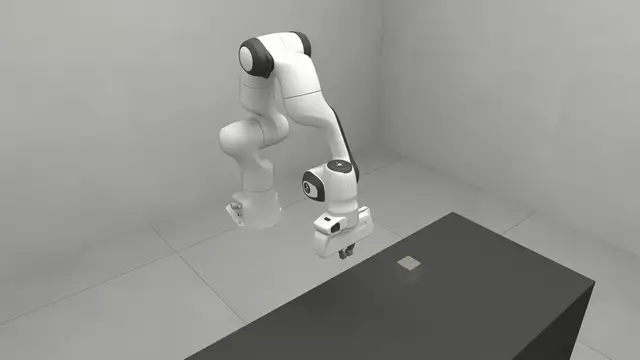
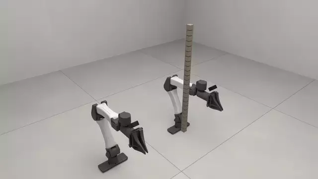

# Extending

Adding a robot, or a new kind of simulated thing, without editing the library.
`02_suction.py` is a hand of another sort: a vacuum cup,
[`robosimstudio/robots/grippers/suction.py`](../../robosimstudio/robots/grippers/suction.py),
that bolts to any imported wrist and seals and holds by
[`robosimstudio/core/suction.py`](../../robosimstudio/core/suction.py). The cup
seals when its face is within 2 mm of a flat face of the part and square to it
within 15 degrees. It holds by a MuJoCo weld when the part shares the arm's
solver, and otherwise by a spring that lets go past the vacuum's pull.

<!-- examples:start: written by scripts/example_readmes.py from each script's docstring -->

## Add a robot



A robot the library never registered, declared in this script over the Panda's MJCF and driven from the studio.

Handing the spec to `rss.robot` builds it as a registered name
would: an arm panel with a gizmo, IK, and a hand that grips. Drag the gizmo down
onto the cube, press **Close** and lift. To use your own robot, point `asset`
at its MJCF or URDF and rename the joints.

```bash
uv run examples/04_extending/00_add_a_robot.py
```

Source: [`00_add_a_robot.py`](00_add_a_robot.py)

## A new kind of thing



A chain of loose links the library has never heard of, defined in this file: click any link and drag it.

A spec, an entity that builds it, a `Ref` with an accessor of its own, a
kernel that runs every substep, and the registration, with nothing under
`robosimstudio/` edited. The page shows the chain's span, read through that
accessor.

```bash
uv run examples/04_extending/01_new_kind.py
```

Source: [`01_new_kind.py`](01_new_kind.py)

## Pick up a plate


A plate lying flat under the right hand's suction cup and a square 200 mm toward the middle of the bench: drag the hand down onto the plate, tick **Vacuum** in the right arm's panel, lift, carry it over the square and untick.

The plate is 150 by 150 by 6 mm and 0.3 kg, flat on the bench, so a parallel
jaw has nothing to close across; `yam_bimanual_suction` carries a vacuum cup
on its right arm instead, its face 100 mm over the plate and pointing down at
home, and keeps the left hand's jaws. The cup seals when its face is within
2 mm of the plate and square to it within 15 degrees, and the arm's **Seal**
readout says sealed or not, the gap and the mass held. A hand dragged down
trails the gizmo by a few millimetres, and the panel puts the gizmo back on the
hand when a drag ends that close to it, so put the gizmo a little into the
plate. Tick **Vacuum** once the face is down: ticked on the way down, the cup
seals as soon as the face is within 2 mm and carries the plate about that far
under it.
The arm and the plate share one MuJoCo solver (`rss.MUJOCO_500HZ`), so the
seal is a weld switched on inside the captured graph and the arm carries the
plate's weight. Driven through the panel, the plate rides 198 mm with the cup
less than 1 mm off where it sealed and rests in the square with its top 6 mm
over the bench, at 3.5 ms per control step (`tests/test_suction_pick`, RTX
PRO 6000, GPU 5).

```bash
uv run examples/04_extending/02_suction.py
```

Source: [`02_suction.py`](02_suction.py)

<!-- examples:end -->

## Add a robot

A robot is an `EmbodimentSpec` (file, arms, base pose), plus a `GripperSpec`
only if its hand is not in the registry. Both are frozen dataclasses.

### From a file

Name the joints and the wrist body, and the arm builds, solves IK and takes
joint-position commands:

```python
import robosimstudio as rss

arm = rss.ArmSpec(
    name="right",
    joint_names=tuple(f"robot0_joint{i}" for i in range(1, 8)),
    ee_body_name="robot0_link7",
    gripper="franka_hand_robosuite",  # a registered hand; leave it out for a bare arm
    home_q=(0.0, 0.196, 0.0, -2.618, 0.0, 2.942, 0.785),  # the tool centre 99 mm up, 457 mm out, pointing down
)

scene = rss.Scene(cell="void", physics=rss.MUJOCO_500HZ)  # arm and cube in one engine, so friction holds
scene.add(rss.robot(asset="embodiments/panda/panda_standalone.xml", arms=[arm], at=(0, 0, 0, 0, 0, 0, 1)))
scene.add(rss.box(name="cube", half=(0.025,) * 3, at=(0.457, 0.0, 0.025)))  # on the floor, under the hand
sim = scene.build(control_mode="joint_position")
rss.view(sim)    # drag the wrist gizmo down onto the cube, press Close, drag it up
```

- `asset` is a path under the asset roots. `assets/embodiments/<name>/` is
  where the shipped files are. `.xml` is MJCF and `.urdf` is URDF. A USD stage
  needs the `[usd]` extra.
- `at` is where the base goes, in the work-surface frame: a position
  `(x, y, z)`, or a pose `(x, y, z, qx, qy, qz, qw)`.
- A hand is named from the hand registry, because its finger bodies, travel and
  tool-centre point are measured facts. `./ctl catalog grippers` lists the
  names.

### Registered under a name

A spec registered at import time is a robot `rss.robot` finds by name:

```python
from robosimstudio.robots import register_embodiment

register_embodiment(
    rss.EmbodimentSpec(
        name="my_panda",
        asset=rss.AssetSpec(path="embodiments/panda/panda_standalone.xml"),
        arms=(arm,),
        base_offset=(-0.6, -0.115, 0.132, 0.0, 0.0, 0.0, 1.0),  # the mount, in the work-surface frame
    )
)

scene = rss.Scene(cell="bench_075", physics=rss.MUJOCO_500HZ)
scene.add(rss.robot("my_panda"))
scene.add(rss.box(name="cube", half=(0.025,) * 3, at=(-0.143, -0.115, 0.025)))  # under the hand
sim = scene.build(control_mode="joint_position")
```

`register_embodiment` and `register_gripper` are imported from
`robosimstudio.robots`. The shipped robots are registered the same way, in
`robosimstudio/robots/embodiments/` and `robosimstudio/robots/grippers/`, one
module each. A registered robot stands where its `base_offset` says; `at` on
`rss.robot` is read only when the spec has none.

### The fields that matter

`EmbodimentSpec`:

| Field | Decides |
| --- | --- |
| `asset` | The file. |
| `arms` | One `ArmSpec` per arm. |
| `base_offset` | Where the base stands, in the work-surface frame. |
| `gripper` | The default hand, by registry name. An arm's own `gripper` overrides it. |
| `arm_actuation`, `gripper_actuation` | Servo gains: `ActuationSpec(target_ke, target_kd)`. |
| `hull_colliders` | Replace each link's collider with its convex hull. |
| `decompose_colliders` | Links to decompose into convex pieces instead. Use it on fingertips. |
| `enable_self_collisions`, `cross_arm_collisions` | Whether links collide within an arm, and whether two arms are solid to each other. |
| `gravcomp` | Gravity compensation. |
| `urdf` | The arm as a URDF. IK runs on [PyRoKi](https://github.com/chungmin99/pyroki) from it, checked against the model at build; an arm without one is solved by Newton's own solver. |
| `ik_iterations` | Iterations of the fallback solver, 8 by default. |
| `color`, `finish` | The look. Leave unset to keep the file's own materials. |

`ArmSpec`: `name`, `joint_names` in order (or a `joint_prefix`), `ee_body_name`
for the body the hand bolts onto, `gripper` and `home_q`.

`GripperSpec`, for a hand of your own:

| Field | Decides |
| --- | --- |
| `finger_names`, `finger_open_q`, `finger_closed_q` | The finger joints and their travel. The command channel is 0 for open and 1 for shut. |
| `tcp_body`, `tcp_offset`, `approach_axis`, `close_axis` | The tool-centre point and how the hand approaches and closes. |
| `finger_bodies`, `pad_half_span`, `pad_thickness`, `pad_depth`, `tip_reach` | The pads, as a grasp measures them. |
| `asset`, `mount_body`, `mount_xform` | An attached hand: its own file and where it bolts on. A hand welded into the arm's file leaves these unset. |

### Check it

```python
from robosimstudio.robots.registry import get_embodiment, resolve_gripper

spec = get_embodiment("my_panda")
print([a.name for a in spec.arms], resolve_gripper(spec, spec.arms[0]).name)    # ['right'] franka_hand_robosuite
```


## Import a SimReady asset

NVIDIA's [SimReady assets](https://huggingface.co/datasets/nvidia/simready-assets)
(CC-BY-4.0) are USD stages that state their own mass, friction and colliders.
They need the `[usd]` extra. Download the asset folders you want and point at
the `sm_*.usd` file in each:

```python
scene = rss.Scene(cell="bench_075", physics=rss.MUJOCO_500HZ)
scene.add(rss.body(name="bottle", asset="simready/bottle_laboratory_a01/simready_usd/sm_bottle_laboratory_a01_01.usd",
                   at=(0.0, 0.1, 0.0)))
scene.add(rss.articulated(name="cabinet", asset="simready/cabinet_file_a01/simready_usd/sm_cabinet_file_a01_01.usd",
                          at=(0.6, 0.0, 0.0), joints={"drawer_02": 0.12}))
sim = scene.build()
drawer = sim.handles.objects["cabinet"].joint("drawer_02")
print(drawer.coordinate_from_bodies(sim.pipeline.state_0.body_q.numpy()))    # 0.12
```

- The asset's origin is its base, so `z = 0` stands it on the surface.
- `rss.body` takes a one-body asset, or one whose parts are all held by fixed
  joints (a bottle and its cap); those become one body.
- `rss.articulated` takes one with moving joints. `fixed_base=True` (the
  default) bolts its root part to the world; `False` lets the whole thing be
  carried. Its handle names the parts and joints the asset declares
  (`joint_drawer_02_joint_00` is `drawer_02`), and `joints=` starts any of
  them elsewhere. `rss.JointSpec` overrides a joint's damping, friction or drive.
- A goal asks how far a joint is open with the `opening` atom over a `joint`
  feature: 0 at its lower limit, 1 at its upper.
- The stage's `Newton` physics variant is selected on import, and joints that
  belong to no articulation are given one root on the stage's default prim. These
  edits go to a session layer; the file is not changed.
- An asset in separate parts (a jar and its lid, a storage box whose lid has no
  hinge joint) is one entity with each part its own articulation. With
  `fixed_base=True` the heaviest part is bolted down and the rest are free; with
  `False` every part is free.
- Joints that close a loop (a pair of pliers) import with the closing joint
  outside the tree, and MuJoCo holds it as an equality. The joint is not in the
  handle's `joints`, since its coordinate follows from the others.
- A part the asset rests outside its own joint's limits starts at the nearer
  limit, with a warning. A start you state outside them is refused.
- A mesh bound to several materials (a kettle's metal body and wooden handle) is
  drawn in each of them.
- A drawer task wants the arm, the cabinet and what goes in the drawer in one
  engine, so use an all-MuJoCo arrangement such as `rss.MUJOCO_500HZ`.
- SimReady collides every mesh as authored, a triangle mesh, and MuJoCo's own
  contacts collide a mesh as its convex hull. So a part that rests *inside* a
  concave one (crates on a shelf rack) starts inside the shelf's hull and is
  thrown off. There are two fixes:
  - Use Newton's contacts:
    `replace(rss.MUJOCO_500HZ, backends=(("*", rss.backend("mujoco", nconmax=4096, njmax=4096, use_mujoco_contacts=False)),))`.
  - Decompose the colliders:
    `asset=rss.AssetSpec(path=..., approximate="coacd", keep_visual=True)`.
    This keeps the authored masses and settles the rack on MuJoCo's contacts, but
    the decomposition takes minutes per asset.

## Add a kind of thing

### Two routes

- **Reimplement a kind that exists.** Register an `Entity`
  under a name of your own and ask for it from the stock spec with
  `entity="my_cloth"`. The spec, the materials and the studio's cloth panel stay.
- **Add a new kind.** Write a spec, declare the kind with
  `register_domain`, and register the entity that builds it.

### The registration calls

| Call | Registers |
| --- | --- |
| `rss.register_domain` | A kind: the state its things own, the role they play, what they touch |
| `rss.register_entity` | A class that builds a thing, under a name a spec asks for |
| `rss.register_cell` | A place to stand things in |
| `rss.register_backend` | A solver, under an alias `rss.backend` accepts |
| `rss.register_coupler` | A way for two solvers to exchange forces |

Registering the same thing twice with the same value is accepted.

### A second implementation of cloth

See [`01_cloth/04_your_own_cloth.py`](../01_cloth/04_your_own_cloth.py): register
an `Entity` subclass (with `ParticleMixin`) under a name, then set
`entity="my_cloth"` on a stock `ClothSpec`.

### A kind of your own

```python
from dataclasses import dataclass, field

import numpy as np
import warp as wp

import robosimstudio as rss


@dataclass(frozen=True, kw_only=True)
class StackSpec:
    entity: str = "stack"
    name: str = "stack"
    count: int = 5
    half: float = 0.02
    at: tuple[float, float, float] = (0.0, 0.0, 0.3)
    sim: object = field(default_factory=lambda: rss.SimRequirements(domain="stack", contacts=rss.contacts_with("surface")))


rss.register_domain("stack", state=("bodies", "joints", "shapes"), reads="rigid", role="objects",
                    contacts=("surface",), summary="A column of loose blocks.")


@rss.register_entity("stack")
class Stack(rss.Entity):
    domain = "stack"

    def build(self, builder, episode):
        spec = self.spec
        self.bodies = []
        for i in range(spec.count):
            pose = self.placed(np.array([*spec.at, 0.0, 0.0, 0.0, 1.0]))
            pose[2] += i * 2.2 * spec.half
            body = builder.add_body(xform=wp.transform(tuple(map(float, pose[:3])), wp.quat(*map(float, pose[3:]))), label=f"{spec.name}_{i}")
            builder.add_shape_box(body, hx=spec.half, hy=spec.half, hz=spec.half, label=f"{spec.name}_{i}")
            self.bodies.append(body)

    def handle(self, model):
        from robosimstudio.scene.handles import EntityHandle

        return EntityHandle(name=self.name, body=self.bodies[0], bodies=tuple(self.bodies))


scene = rss.Scene(cell="bench_075")
stack = scene.add(StackSpec(count=5))
sim = scene.build()
sim.run(120).sync()
print(stack.position)    # the bottom block, resting on the bench
```

- The spec is any frozen dataclass: `entity` names the class that builds it,
  `sim` the kind and its default contacts.
- `register_domain`: `state` from `bodies|joints|particles|shapes`, `reads` is
  `rigid` or `cloth`, `role` is `objects|fixtures|deformables`.
- `handle` makes it clickable. For your own accessors, subclass `Ref` and set
  `ref = MyRef` on the entity; for a per-substep kernel, override
  `contribute_hooks`. [`01_new_kind.py`](01_new_kind.py) does both.

### Where the shipped implementations are

`robosimstudio_materials/cloth.py`, `soft.py` and `rod/` back `rss.sheet`,
`rss.sponge` and `rss.rod` (importable as `robosimstudio_materials.cloth`, `.soft`
and `.rod`); the library scans that package the first time a kind is looked up.
A folder of your own is scanned when `ROBOSIMSTUDIO_DOMAIN_ROOTS` names it or
`robosimstudio.roots.add_domain_root` is called with it.

**See also:** `robosimstudio/robots/embodiments/panda.py` (a registered robot);
the docstrings of `Entity`, `rss.SimRequirements`, `contacts_with` and each
`rss.register_*`; `examples/02_soft/02_your_own_soft.py`.
