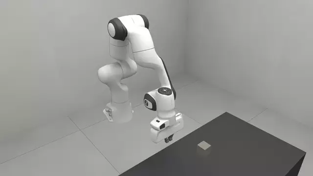
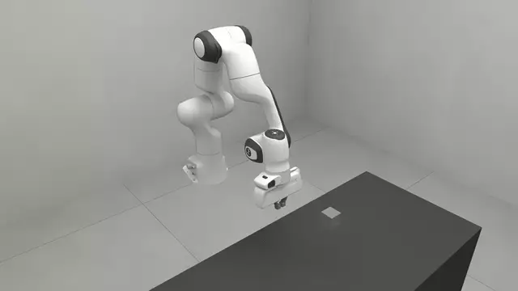
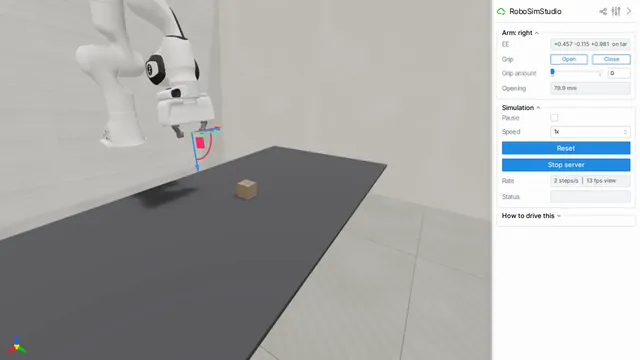
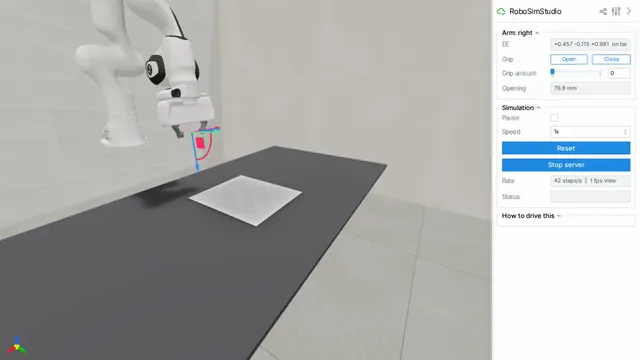
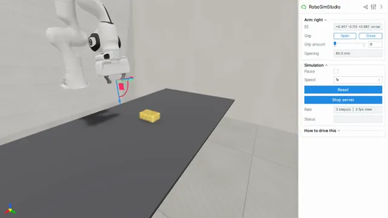
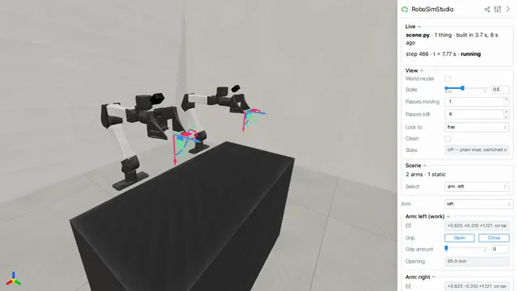

# Studio

The browser page over a built scene: what it does, how to
open it, and how to record from it.

<!-- examples:start: written by scripts/example_readmes.py from each script's docstring -->

## Your own panel



A folder of your own on the studio page: a slider, a button that tosses the cube, and a readout of its height.

`page=` on `rss.view` is called once with the live page after
its own panels are built, and `studio.gui` is viser's GUI API, so anything
written for a bare `ViserServer` drops in. One rule: a viser callback runs on
the server's thread and may only assign; the calls that touch the simulation go
in `studio.each_step`, which runs on the main thread once per control step.

**Key features:**

* `page=` on `rss.view` for controls of your own beside the studio's
* `studio.gui.add_folder`, `add_slider`, `add_button` and `add_number`, viser's own
* `studio.each_step` for the work that touches the simulation
* `rss.Ref.bodies` and `rss.Ref.position` to reach the cube's state

```bash
uv run examples/05_studio/00_your_own_panel.py
```

Source: [`00_your_own_panel.py`](00_your_own_panel.py)

## Render a still and a video



Headless: one path-traced still of a scene, then a short video of it running, with no page open.

`rss.Sim.render` photographs the scene as it stands through a
camera you declare: the room, the lights and the materials, path traced by
`ovrtx` on a GPU with RT cores. On one without them, or with `ovrtx` left
out, the same call draws the colliders alone and says why once;
`ROBOSIMSTUDIO_RENDERER` picks either by name. `rss.Sim.record`
steps the scene and writes what the same camera sees to an mp4.

**Key features:**

* `rss.CameraSpec` to declare a camera: where it stands, what it looks at, its field of view and size
* `rss.Sim.render` for one frame, as `{"rgb": uint8 [H, W, 3]}`
* `rss.Sim.record` for a video of the scene running

```bash
uv run examples/05_studio/01_render.py
```

Source: [`01_render.py`](01_render.py)

<!-- examples:end -->

## Opening it

```python
import robosimstudio as rss

scene = rss.Scene(cell="bench_075")
scene.add(rss.robot("yam_bimanual"))
scene.add(rss.box(name="cube", half=(0.025,) * 3, at=(0, 0.1, 0.2)))
scene.add(rss.sheet(name="towel", size=(0.3, 0.3), cells=(20, 20), at=(-0.15, -0.3, 0.05)))
sim = scene.build(control_mode="joint_position")

rss.view(sim)
```

`rss.view` serves the page on port 8080, prints its
address, and steps the scene until you close the tab or press **Stop server**.

## What it looks like

Recorded from the page in a browser.


*Click the cube and it is held; drag its handle; let go and it falls. Reset puts it back.*


*Drag the hand's gizmo and the arm follows; Close shuts the jaw on the cube; lift it and set it down.*


*A click on the cloth pins a patch to a handle. Lift it, carry it, let go.*


*Two holds on two corners with Move together on: one drag carries the sheet flat.*


*The hand driven down onto a sponge: it squashes under the jaw and recovers.*


*The live page. Save a box into scene.py, then a towel: each save rebuilds the page.*

## On the page

- Click a rigid body and it comes up on a handle you can drag. The body stays
  dynamic, so you can push one thing with another or tug on something a hand
  holds.
- Click a patch of cloth to pin it to a handle. A second click elsewhere adds a
  second handle, and **Move together** carries both as one.
- Drag an arm's gizmo to move the arm through IK. **Grip** opens and closes its
  fingers.
- **Pause**, **Speed** and **Reset** are in the Simulation folder.

`rss.view` opens with the `drive` panels, which are the ones above.
`rss.view(sim, panels="all")` adds the rest:

| Folder | What it does |
| --- | --- |
| Material | Live sliders on each cloth's fabric. Some changes rebuild the scene. |
| Physics | Sliders on the arrangement the scene was built with. |
| Record | Keeps what you drive as a take. |
| Video | Renders the last seconds to an mp4. |
| Appearance | Scenery, cloth look, lights and shadows. |
| Leader arm | Drives an arm from a real one. See [Teleoperation](../06_teleop/README.md). |

## Arguments

| Argument | Default | Meaning |
| --- | --- | --- |
| `panels` | `"drive"` | `"drive"`, `"all"`, or a tuple of panel keys. |
| `page` | `None` | A function called with the session, to add your own controls. |
| `render_every` | `1` | Draw one frame per this many control steps. 4 trades frame rate for step rate. |
| `port` | `8080` | The port to serve on. |
| `share` | `False` | Ask viser for a public URL as well. |
| `handles` | `2` | How many things may be held at once, per kind. |
| `speed` | `"1x"` | Playback rate at start: `"1x"`, `"0.5x"`, `"0.25x"`, `"0.1x"` or `"max"`. |
| `dark` | `False` | Dark page and canvas. |
| `scenery` | `False` | Draw the bench. It is hidden by default because it swallows clicks meant for the gizmos. |
| `config` | `None` | A whole `StudioConfig`. The arguments above are applied on top of it. |

## Your own panel

`page` receives the live session after its panels are built. `studio.gui` is
viser's own GUI API, and `studio.each_step` runs a function every control step:

```python
def page(studio):
    height = studio.gui.add_number("cube height (mm)", 0.0, disabled=True)
    studio.each_step(lambda: setattr(height, "value", round(1000 * sim["cube"].position[2], 1)))

rss.view(sim, page=page)
```

## Recording and video

**Start take** and **Stop take** write a run directory under `outputs/studio/`,
named after the scene and the time:

```text
outputs/studio/scene/20261005-040937/
  demos/0000/steps.npz        # every control step of the take
  demos/0000/meta.json
  demos/0000/privileged.npz
  demos/episode_results.jsonl
  demos/run_meta.json
```

**Export video** renders the state the page has buffered, without simulating
again, to `video_001_rtx/<camera>.mp4` in the same directory. A video needs a
camera in the scene:

```python
scene.add(rss.CameraSpec(name="front", eye=(1.6, 0.0, 1.3), look_at=(0.6, 0.0, 0.8)))
```

`eye` and `look_at` are in the world frame. The defaults keep every second
control step, 900 frames in all, and write 30 frames per second. Set
`video_fps`, `capture_every`, `buffer` and `out` on a `StudioConfig`.

## Rendering

Every picture -- the live camera view, the exported video, **World model**,
`./ctl snapshot`, `sim.render()` and a policy's cameras -- comes from one
renderer, picked in this order:

1. A name in code wins: `bench.Env(..., renderer="tiled")`. `"auto"` names none.
2. Else `ROBOSIMSTUDIO_RENDERER`, for a machine or a shell: `rtx`, `tiled` or `auto`.
3. Else `rtx`, path traced by `ovrtx`, where it is installed and the scene's GPU
   has RT cores -- T4, A10, A40, L4, L40S, the RTX cards. Else `tiled`, which
   draws the colliders alone: A100, H100 and B200 have no RT cores. The first
   picture says which and why, once; World model's switch says it on hover.

A named `rtx` is tried even on a GPU without RT cores, and raises where `ovrtx`
is not installed rather than drawing something else.

`uv run` and `uv sync` install `ovrtx` from a checkout by default (the `rtx`
dependency group, 1.8 GB from NVIDIA's index). On a machine that cannot use it,
leave it out with `UV_NO_GROUP=rtx`. With pip it is the `[rtx]` extra:

```bash
uv sync --extra rtx                     # from a checkout
pip install "robosimstudio[rtx] @ git+https://github.com/robosimstudio/robosimstudio" \
    --extra-index-url https://pypi.nvidia.com   # into another environment
```

Headless, with no page open:

```python
frame = sim.render(camera)            # {"rgb": uint8 [H, W, 3]}
sim.record("clip", steps=120, camera=camera)   # clip/<camera>.mp4
```

## Remote machines

The page listens on all network interfaces (viser's default; Newton's viewer
has no option to bind one), so anyone who can reach the port can drive the
scene. On a shared network keep the port behind a firewall and reach it with
`ssh -L 8080:localhost:8080 <box>`. `share=True` also asks viser for a public
URL, which opens from anywhere; the request blocks until the tunnel answers.
Pick the GPU with `CUDA_VISIBLE_DEVICES`, one page per process.

## The whole page from code

```python
import robosimstudio as rss
from robosimstudio_studio import StudioConfig, StudioSession

scene = rss.Scene(cell="bench_075")
scene.add(rss.robot("panda"))
scene.add(rss.box(name="cube", half=(0.025,) * 3, at=(0, 0, 0.2)))

config = StudioConfig(panels="all", share=False, out="takes")
StudioSession(scene.build(), config=config).run()
```


**See also:**

- `rss.view` and `CameraSpec`
- `StudioConfig` for every field
- `examples/01_rigid/00_drag_things.py` and `examples/02_cloth/00_towel.py`
- `examples/05_studio/00_your_own_panel.py` and `examples/05_studio/01_render.py`
