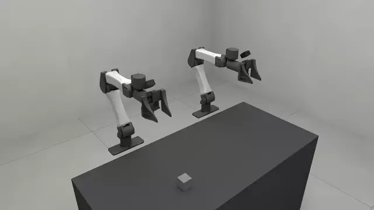
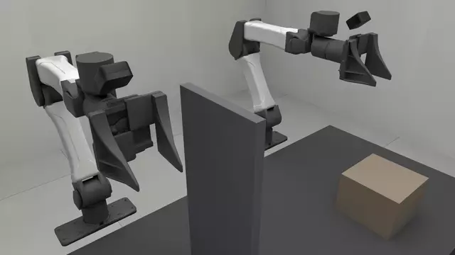

# Teleoperation

Driving a simulated YAM from a real leader arm, and feeling
what the simulated arm runs into on the leader's own servos.

<!-- examples:start: written by scripts/example_readmes.py from each script's docstring -->

## Leader arm



Drive the simulated YAM from a real leader arm, read only.

Each control step the script reads every connected leader, converts servo ticks
to joint angles through a calibration file, and applies them as one
`joint_position` action. Nothing is written to a servo, so nothing can push
back on your hand. The cube is on the arm's own engine, `rss.MUJOCO_500HZ`, so
jaws you close on it hold it by friction. `--simulate` swaps the arm for a
scripted hand that sweeps both arms and works the jaws, over a table of
registers instead of a bus.

**Key features:**

* `resolve_leaders` looks each calibration up by its adapter's serial
* `read_action` reads one arm as `[q_0 .. q_5, grip]`
* `apply_arm_actions` drives only the arms that have a leader
* `YAM_TELEOP_ARM` gives the follower servo gains that keep up with a hand

Needs the `[lerobot-feetech]` extra and a calibrated leader arm.

```bash
uv run --extra lerobot-feetech examples/06_teleop/00_leader_arm.py
```

Source: [`00_leader_arm.py`](00_leader_arm.py)

## Force feedback



Feel what the simulated arm runs into, on the leader arm's own servos.

Where the simulated arm cannot reach where your hand is -- its side against the
welded panel, its hand pressed on the crate -- the gap is rendered as torque on
the leader. In free space no motor is energized. Take `--no-feedback` first:
it drives the simulation and never energizes a motor. `--simulate` swaps the
arm for a scripted hand whose sweep meets the panel; a table of registers
renders nothing you can feel.

**Key features:**

* `Teleoperation` owns the servos from the first torque-off to the last
* `status` says which motor is pushing back
* `ComplianceConfig` holds the deadband, ramp, cap and servo gains
* `slab` welds something to push against; a welded cylinder does not stop the arm's capsules

Needs the `[lerobot-feetech]` extra and a calibrated leader arm.

With feedback on, the leader's servos are powered: keep clear of the arm and keep its power switch in reach.

```bash
uv run --extra lerobot-feetech examples/06_teleop/01_force_feedback.py
```

Source: [`01_force_feedback.py`](01_force_feedback.py)

<!-- examples:end -->

## What you need

| Item | What |
| --- | --- |
| Leader arm | A YAM leader on Feetech STS3215 bus servos: six joints and a trigger per arm. A bimanual leader is two arms on two buses. |
| Adapter | One USB-serial adapter per arm (WCH CH340/CH341, USB id `1a86:55d3`). |
| Extra | `lerobot-feetech`: every hardware command below runs with `uv run --extra lerobot-feetech`. The Feetech bus driver comes from `lerobot`. |
| udev rule | `scripts/udev/99-ch340-serial.rules`, so each adapter has a fixed device path. |
| Calibration | A JSON file keyed by adapter serial, written by `scripts/calibrate_leader_arms.py` to `scripts/calibration/local/yam_leader.json` (git-ignored), which is where the scripts here read it by default. `scripts/calibration/yam_leader.json` is a sample for two arms that are not yours. |

The simulated arm is the shipped `yam_bimanual` with servo gains for
teleoperation, `YAM_TELEOP_ARM` and `YAM_TELEOP_GRIP` in
`robosimstudio.robots.teleop.follower`. The stock robot is unchanged; the gains
are an override the scene applies. Nothing here needs a task: every script
builds a bare scene, `rss.Scene(cell="bench_075")` plus `rss.robot(...)`.

## The udev rule

`/dev/ttyACM0` is whichever adapter enumerated first and can swap across a
reboot or a re-plug. Address each adapter by its serial number instead:

```bash
sudo cp scripts/udev/99-ch340-serial.rules /etc/udev/rules.d/
sudo udevadm control --reload-rules && sudo udevadm trigger
ls -l /dev/ch340-*
```

Each adapter now appears as `/dev/ch340-<serial>`. The calibration file is keyed
by that same serial: a calibration is a fact about one arm's servos and horns,
not about which side of the desk it stands on, so two arms that swap places
keep the right numbers. Label each arm's controller with its serial.

## Calibrate

```bash
uv run --extra lerobot-feetech python scripts/calibrate_leader_arms.py \
    --leader left:/dev/ch340-<left-serial>,right:/dev/ch340-<right-serial> \
    --out scripts/calibration/local/yam_leader.json
```

The whole workflow is in the browser page the tool opens, on port 8081. A
translucent ghost stands at the target pose and the arm mesh follows the leader.

| Step | In the page |
| --- | --- |
| **Start** | Opens the first arm's bus, torque off. |
| Each joint, five poses | Move that one leader joint into the ghost and press **Capture**. **Invert direction** flips the preview if it moves the wrong way. |
| Gripper | Open fully, **Capture**; close fully, **Capture**. |
| Next arm | Automatic. The file is written after every capture, so an interrupted run resumes where it stopped. |

The five poses fit `ticks = slope * radians + intercept` per joint, which gives
`ticks_per_radian`, `sign` and `offset_ticks` together. A residual over 40 ticks
is flagged in the results list; **Redo last joint** sweeps it again.

| Flag | Does |
| --- | --- |
| `--leader` | `<arm>:<port>` pairs. The arm names are the robot's own, `left` and `right`. |
| `--out` | The file to write, and to resume from. |
| `--embodiment`, `--cell` | Another registered robot or cell. The defaults are `yam_bimanual` and `bench_075`. |
| `--zero-only` | One capture per arm at the home pose. Rewrites every `offset_ticks` and keeps scale and sign: for a slipped horn. |
| `--gripper-only` | The two gripper captures alone. |

The file holds one entry per serial, `label` being for the person reading it:

```json
{"<serial>": {"label": "right",
  "joints": [{"name": "right_j0", "ticks_per_radian": 651.9, "sign": -1.0,
              "offset_ticks": 2002.0, "scale_source": "fitted"}, "..."],
  "gripper": {"name": "right_grip", "open_ticks": 2128.0, "closed_ticks": 2765.0}}}
```

`radians = sign * (ticks - offset_ticks) / ticks_per_radian`, with the
difference taken the short way round the encoder's 4096-count turn. Joints are in
servo-id order; ids `1..N` are assigned in that order when a bus opens.

## Check the signs

```bash
uv run --extra lerobot-feetech python scripts/check_leader_signs.py --leader right:/dev/ch340-<serial>
```

Read-only. Move one joint at a time and watch its signed `delta`. A joint whose
number climbs while the simulated arm moves the other way has the wrong `sign`;
flip that one entry in the file.

## Drive the simulation from the leader

```bash
uv run --extra lerobot-feetech examples/06_teleop/00_leader_arm.py --leader right:/dev/ch340-<serial>
```

Every control step the script reads the leader, converts ticks to joint angles
through the calibration, and applies them as one `joint_position` action.
Nothing is written to a servo. Name one `--leader` pair per arm you have; an arm
without one keeps its gizmo.

The studio offers the same thing as a panel. Open a bare scene with
`panels="all"` and the ports in the config, then in the **Leader arm** folder
press **Connect** and tick **Drive from leader arm**. Untick it and the arm
stays where the leader left it, for the gizmo to pick up.

```python
from robosimstudio_studio import StudioConfig

rss.view(sim, panels="all", config=StudioConfig(
    leader_arm_ports=(("right", "/dev/ch340-<serial>"),),
    leader_arm_calibration="scripts/calibration/local/yam_leader.json"))
```

Without hardware, `--simulate` runs a scripted hand over a table of registers:
both arms sweep and the jaws open and close, as in the [leader-arm clip](#leader-arm)
above. It exercises the loop and shows nothing about feel.

## Force feedback

> **Note.** Force feedback is experimental. The version in this release has been checked
> against a simulated servo bus and has not yet been run on a leader arm. Work
> through the [rig checklist](#rig-checklist) below before you rely on it.

```bash
uv run --extra lerobot-feetech examples/06_teleop/01_force_feedback.py --leader right:/dev/ch340-<serial> --no-feedback
uv run --extra lerobot-feetech examples/06_teleop/01_force_feedback.py --leader right:/dev/ch340-<serial>
```

The [force-feedback clip](#force-feedback) above is the `--simulate` run: the
Force feedback folder names the motor that pushes back.

Take `--no-feedback` first. It drives the scene from the leader and never
energizes a motor, which is how a calibration is checked with nothing able to
push back. The scene has a panel welded to the bench beside the right hand and a
20 kg crate under the left.

**What you feel.** The leader is the target and the simulated arm is the state.
Where the arm cannot reach your hand, its side on the panel, its hand on the
crate or its jaw on something solid, the gap between the two is rendered on the
leader: each blocked servo gets a goal that leads your hand back toward where
the arm is, under a torque limit. The further behind the arm is, the harder the
pull, up to a cap.

**Two clocks.** Each leader arm runs on a thread of its own at 100 Hz, reading
the bus and writing servo registers. The page steps the scene at its control
rate, 60 Hz by default, applies the leader pose and reads the arm back. Contact
is rendered at a steady rate whatever the scene costs to step.

**Free space stays free.** A motor is energized only once its joint's mismatch
leaves a deadband. The deadband is 0.04 rad at rest and rises with the joint's
own speed by 0.045 s × speed, capped at 0.16 rad: a position-controlled arm lags
its target by about that long, and the lag of a moving hand must not read as
contact. The grip slot has its own figures, 0.02 s and a cap of 0.08 of the
stroke. Each follower sample is compared with the pose the arm was chasing when
it was measured, so a late page step is not felt either. A motor that is
already energized lets go at three quarters of that deadband rather than at it,
so a joint resting on the threshold does not switch on and off; between the two
the goal written is your hand's own position.

**The staleness gate and the re-arm rule.** A follower sample older than the
stale limit, 0.25 s or three of the page's own step intervals if that is longer,
disarms every motor: a paused page, a scene being rebuilt and a closed tab are
the same event. A disarmed joint energizes again only after its leader and
follower have agreed, continuously, for 0.5 s, and then only on a later sample
that leaves the deadband.

The page shows one status line per arm: `free`, `pushing back: right_j0 -0.21`,
`waiting for alignment`, `suspended`. `--trace PATH` writes per-tick timing on
the way out; `scripts/analyze_leader_trace.py PATH` reads it.

| Knob (`ComplianceConfig`) | Default | Meaning |
| --- | --- | --- |
| `deadband` | 0.04 | Mismatch below which nothing is rendered, in rad or stroke fraction. |
| `velocity_deadband`, `max_deadband` | 0.045 s, 0.16 | How the deadband rises with speed, and its ceiling. |
| `release_hysteresis` | 0.01 | How far back inside the deadband the mismatch must fall before an energized joint lets go. Kept in proportion as the deadband rises: a quarter of it at these defaults. |
| `ramp_gain` | 5.0 | How steeply the correction grows past the deadband. |
| `max_error` | 0.2 | Cap on how far the goal leads the hand. |
| `p_coefficient`, `d_coefficient` | 30, 5 | Feetech position-loop gains while a joint is energized. |
| `torque_limit` | 300 | Feetech torque duty cap, 0-1000: how hard the arm can push. |

Pass a `ComplianceConfig` to `Teleoperation` in
`robosimstudio.robots.teleop.force_feedback` to change them. The example uses
the defaults.

## Safety

- Torque is off at rest, off while the page is stale, and off on the way out.
  The page closing, Ctrl-C, SIGTERM and a fault take the same path, which also
  puts the servos' own gains back.
- With feedback on, the servos are powered and the arm can move by itself. Keep
  clear of it and keep its power switch in reach.
- A process killed outright (`kill -9`, a power cut to the computer) cannot run
  that path. The servos keep their last goal and torque limit until their own
  power is cut.
- Startup refuses to arm against a servo that comes up with a nonzero torque
  limit. Power-cycle the arm.
- Match poses before you connect. The leader's angles become the targets on the
  first step; a leader far from the simulated arm's pose makes it jump.

## Troubleshooting

| Symptom | Cause | Fix |
| --- | --- | --- |
| A simulated joint moves the opposite way | The wrong `sign` for that joint | Flip that entry in the file. `check_leader_signs.py` shows which. |
| Every joint reads a constant angle off | A slipped horn or a re-seated servo moved the zero | `calibrate_leader_arms.py --zero-only`. |
| One joint jumps a whole turn at one point of its travel | Its `offset_ticks` is a turn out. Readings wrap the short way round the 4096-count seam, so a correct offset never jumps | Re-zero that arm. |
| Free motion pushes back | Lag read as contact. The deadband absorbs about 45 ms of it, which is what a recorded session measured | Keep the scene light and `render_every=1`; check the loop period and the page gap with `--trace`. Use the teleoperation gains: at the asset's own gains the arm was a 92 ms delay line and a hand at 0.8 rad/s sat over the deadband 65% of the time in free space; with `YAM_TELEOP_ARM`, 18 ms and 0%. |
| A joint pushes back while still, touching nothing | The model's joint range clamps a target the leader's travel puts outside it | `YAM_TELEOP_ARM` removes the arm joints' limits. One wrist joint measured 0.287 rad outside its range at rest before that. |
| `no simulation state for over 0.25 s; feedback suspended` | The page paused, or steps slower than the stale limit | Resume. Hold still for 0.5 s and the arm re-arms. |
| `refusing to arm against nonzero torque limits` | A previous run did not reach its torque-off | Power-cycle the leader. |
| `could not open the leader on /dev/...` | Nothing on the port, or another process holds it | Check power and cable. Close the studio's **Leader arm** panel or the other script; one bus has one reader. |

## Rig checklist

The commands a person with a leader arm runs to verify
teleoperation and force feedback, in order, with what to observe at each step
and what counts as pass.

Everything the software can check without an arm has been checked: the loop
closed against a stepped scene with a table of registers in place of the bus,
free space rendering nothing, a welded wall and a stalled jaw rendering a
correction with the right sign. What only the rig can show is what reaches a
real servo and how it feels. That is what this checklist is for.

### Before you start

- The extra is installed: `uv sync --extra lerobot-feetech` in a checkout (the
  commands below pass `--extra lerobot-feetech` too), or
  `pip install "robosimstudio[lerobot-feetech] @ git+https://github.com/robosimstudio/robosimstudio"`.
- The udev rule is installed; see [The udev rule](#the-udev-rule) above.
- The leader arm is powered, its power switch is within reach, and nothing
  stands in its sweep.
- A browser reaches the machine's ports 8080 and 8081, directly or through an
  SSH tunnel.

Replace `<serial>` below with the serial on the adapter's label. One arm is
enough; a second arm is a second `<arm>:<port>` pair in `--leader`.

### 1. The adapter has a fixed path

| | |
| --- | --- |
| Run | `ls -l /dev/ch340-*` |
| Observe | One symlink per adapter, named by its serial. |
| Pass | Every connected arm is listed and its serial matches its label. |
| Fail | Nothing listed: the rule is not installed, or the adapter is not a CH340. `lsusb` should show `1a86:55d3`. |

### 2. Calibrate

| | |
| --- | --- |
| Run | `uv run --extra lerobot-feetech python scripts/calibrate_leader_arms.py --leader right:/dev/ch340-<serial> --out scripts/calibration/local/yam_leader.json` and open `http://localhost:8081`. |
| Observe | After **Start**, the status line says the arm is connected with torque off, and the arm hangs loose. A green ghost stands at each target; the arm mesh follows the leader as you move it. |
| Pass | Every joint fits with a residual under 40 ticks (no warning in the results list). The gripper's two captures differ by several hundred ticks. The file holds an entry under your serial with six joints and a gripper. |
| Fail | The mesh moves the wrong way during a sweep: press **Invert direction** before capturing. A residual over 40: **Redo last joint**. A servo does not answer: the tool exits with the bus error; check the daisy chain and power. |

### 3. The signs

| | |
| --- | --- |
| Run | `uv run --extra lerobot-feetech python scripts/check_leader_signs.py --leader right:/dev/ch340-<serial>` |
| Observe | One line per motor with `raw`, `angle` and a signed `delta`; `<-- moving` marks the joint you are moving. |
| Pass | Each joint's `delta` changes only when that joint moves, and the gripper's `cmd` runs 0 at open to 1 at closed. |
| Fail | The gripper runs 1 to 0: its `open_ticks` and `closed_ticks` are swapped in the file. Two lines move for one joint: the servo ids do not match the joint order. |

### 4. Drive the simulation

| | |
| --- | --- |
| Run | `uv run --extra lerobot-feetech examples/06_teleop/00_leader_arm.py --leader right:/dev/ch340-<serial>` and open the page. |
| Observe | The simulated right arm snaps to the leader's pose on the first step and then follows it. Its gizmo is hidden. The left arm keeps its gizmo. |
| Pass | Each of the six joints moves the same way as the leader's, with no visible lag at a normal hand speed. The jaw closes when you squeeze the trigger and opens when you release it. The arm stays loose in your hand throughout. |
| Fail | A joint mirrored: flip its `sign`. The whole arm offset by a constant angle on some joints: `calibrate_leader_arms.py --zero-only`. A joint that jumps a whole turn: re-zero that arm. |

### 5. Force feedback, feedback off

| | |
| --- | --- |
| Run | `uv run --extra lerobot-feetech examples/06_teleop/01_force_feedback.py --leader right:/dev/ch340-<serial> --no-feedback` |
| Observe | The console prints `right: leader on /dev/ch340-<serial> ..., torque off, gains untouched (no feedback)` and `Driving right without feedback: no motor will be energized.` The page's **Force feedback** folder shows `reading only (no motor is energized)`. |
| Pass | The arm drives the simulation as in step 4, stays loose, and no servo warms or hums. Swing the right hand into the panel: the simulated arm stops at it and your hand feels nothing. |
| Fail | `refusing to arm against nonzero torque limits`: power-cycle the arm and rerun. A traceback instead of one sentence: report it. |

### 6. Force feedback on, free space

| | |
| --- | --- |
| Run | `uv run --extra lerobot-feetech examples/06_teleop/01_force_feedback.py --leader right:/dev/ch340-<serial>` |
| Observe | `Force feedback armed on right at 100 Hz. Torque stays off in free space (deadband=0.04+0.045*speed capped 0.16, ...)`. The status says `waiting for alignment`, then, once you have held the arm still for half a second, `[right] alignment held; contact feedback is live again.` and `free`. |
| Pass | Move slowly, then briskly, through empty space, and work the trigger on air. The status stays `free`, no servo energizes, and the arm feels exactly as loose as it did in step 5. |
| Fail | The status flickers to `pushing back` during free motion, or a joint stiffens briefly: lag is being read as contact. Note the joint and the speed, then take step 10. |

### 7. Force feedback on, contact

| | |
| --- | --- |
| Run | The same session as step 6. |
| Observe | Swing the right hand sideways into the panel: the simulated arm stops and the status says `pushing back: right_j0 ...`. Press the left hand down on the crate (a second `--leader` pair) and the status names that arm's shoulder pitch joint. Close the jaw on the panel's edge and the status names `right_grip`. |
| Pass | The leader's base joint pushes back toward where the simulated arm stopped, harder the further you push, and lets go as soon as you back away, with the status returning to `free`. The trigger pushes back open on the panel's edge and not on air. Joints that are not loaded stay loose. |
| Fail | A push on the panel is felt on a wrist joint or not at all: the calibration's `sign` or `offset_ticks` for the base joint is wrong (steps 3 and 4). The pull points the wrong way, away from the arm: stop with Ctrl-C and report it. |

### 8. The staleness gate

| | |
| --- | --- |
| Run | In the same session, press **Pause** on the page while the arm is in contact with the panel. |
| Observe | Within about 0.3 s the console prints `[right] no simulation state for over 0.25 s; feedback suspended.` and the status says `suspended`. |
| Pass | The arm goes slack at that message. After **Pause** again, the status says `waiting for alignment`; hold the leader still where the simulated arm is for half a second and it prints `alignment held; contact feedback is live again.` A joint still in contact when you resume stays off until you have let go and re-aligned. |
| Fail | The arm stays stiff after the message: cut its power and report it. |

### 9. Shutdown

| | |
| --- | --- |
| Run | Ctrl-C in the terminal, once while in contact and once in free space. Also close the browser tab in a third run. |
| Observe | `Stopped; leader torque is off.` and the process exits with code 0. |
| Pass | The arm is slack immediately on each exit. The next start does not say `refusing to arm against nonzero torque limits`: the servos' gains were put back. |
| Fail | `SHUTDOWN ERROR: ...` lines: a servo did not acknowledge its torque-off. Power-cycle the arm, and report the lines. |

### 10. The trace

| | |
| --- | --- |
| Run | `uv run --extra lerobot-feetech examples/06_teleop/01_force_feedback.py --leader right:/dev/ch340-<serial> --trace outputs/ff.json`, repeat steps 6 and 7, exit, then `uv run python scripts/analyze_leader_trace.py outputs/ff.json`. |
| Observe | Per arm: the loop period percentiles against the 10 ms target, where an armed tick's time went, the torque transitions per second, and which slot carried the worst mismatch. Then the page's publish gap. |
| Pass | Few ticks over 1.5 times the target period; transitions reported `calm` outside contact; `follower sample age` p95 within a few page steps; `events` lists no `glitch`. |
| Fail | `CHATTER`: a mismatch sitting at the deadband. `suspend` events with the page open: the scene steps too slowly for the stale limit. A loop period p99 many times the target: the leader thread is starved; close other work on the machine. |

### What the rig decides

Two things are open until someone runs this checklist.

- **Feel.** The gains and limits in `ComplianceConfig` are the ones a reference
  teleoperation rig runs on the same servos. Whether they feel right through
  this scene is a judgement only a hand can make.
- **The comparison.** By default each follower sample is compared with the
  leader pose the arm was chasing when it was measured. The other form, the
  hand's pose at the instant the leader thread looks, is the only one that has
  been felt on hardware; `Teleoperation(..., compare="live")` selects it. If
  step 6 fails and step 10 shows no timing fault, try the other form and report
  which one felt right.

## See also

- `examples/06_teleop/00_leader_arm.py` and `examples/06_teleop/01_force_feedback.py`.
- `robosimstudio.robots.teleop.lerobot_controller`: calibration, tick conversion and the read-only controller.
- `robosimstudio.robots.teleop.force_feedback`: the algorithm, the gates and the servo writes.
- `robosimstudio.robots.teleop.follower`: the follower's gains, and the measurements behind them.
- `robosimstudio.robots.teleop.simulated`: what `--simulate` is and is not.
- `scripts/analyze_leader_trace.py --help`: what each line of the trace report means.
