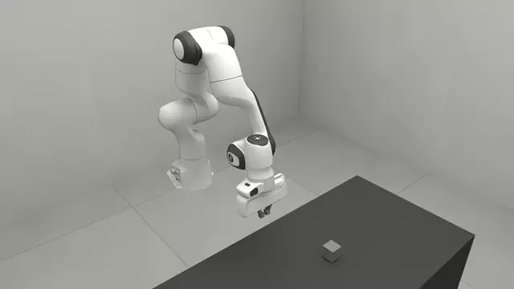
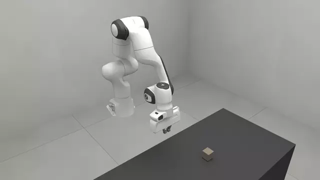
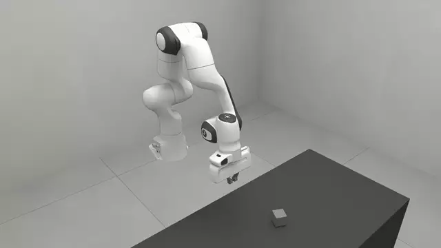

# Tasks

A task: a short document that says what is on the bench and
when an episode counts as done, and how to run one.

<!-- examples:start: written by scripts/example_readmes.py from each script's docstring -->

## Your first task



A task is a short document: what is on the bench, and when it counts as done.

`bench.task` reads the document and `bench.Env` builds it, robot and all.
The studio opens with the goal beside the scene: drag the cube into the square
and the goal turns true.

**Key features:**

* `robosimstudio_bench.task` to write a task as a string
* `robosimstudio.domains.rigid.Body.from_spec` for the type of object the document places
* `robosimstudio_bench.Env`, which `rss.view` opens with its goal panel

```bash
uv run examples/07_tasks/00_your_first_task.py
```

Source: [`00_your_first_task.py`](00_your_first_task.py)

## Goals and rewards



A goal is one clause built from measures; a reward says how close an episode came.

This goal asks for more than "in the square": the cube must also be still and
clear of the hand for a whole second. `once` latches success the first time
that holds, and `(fraction)` pays for each part that holds now. The loop
reads both for one second, then the studio shows each clause as you drag.

**Key features:**

* `once`, `hold-for` and `and` over the `containment`, `speed` and `hands-clear` measures
* `(:reward (fraction))`: partial credit, one share per clause
* `robosimstudio_bench.Env.step`, which returns the reward and `info["success"]`

```bash
uv run examples/07_tasks/01_goals_and_rewards.py
```

Source: [`01_goals_and_rewards.py`](01_goals_and_rewards.py)

## Episodes and samplers



A task has numbered episodes, and a sampler decides how each one starts.

`register_sampler` names a function a document can cite. It returns where the
cube starts in episode *k*, drawn from a generator seeded for that episode, so
`env.reset(k)` builds the same start every time it is asked for.

**Key features:**

* `robosimstudio_bench.register_sampler` and `(:episodes (:count N) (:sampler NAME))`
* `env.reset(k)`: the same start for the same `k`
* `object_poses`: x, y, z and yaw, measured from the middle of the bench top

```bash
uv run examples/07_tasks/02_episodes.py
```

Source: [`02_episodes.py`](02_episodes.py)

<!-- examples:end -->

## A task in a few lines

```python
import robosimstudio as rss
import robosimstudio_bench as bench
from robosimstudio.assetlib import register_asset
from robosimstudio.domains.rigid import Body

register_asset(Body.from_spec(rss.box(name="cube", half=(0.025,) * 3, at=(0.0, 0.1, 0.03)), name="cube_50mm"))

task = bench.task("""
(define (problem cube_in_square)
  (:staging (:scene bench_075) (:embodiment panda) (:physics mujoco_500hz@v1))
  (:objects cube - cube_50mm)
  (:regions (square (:ranges ((0.05 -0.20 0.15 -0.10)))))
  (:goal (>= (containment cube square) 1.0)))
""")
env = bench.Env(task)
rss.view(env)
```

`bench.task` reads the document and registers
it. `bench.Env` builds it, robot and all; an
`Env` is a `Sim`, so the studio opens it with a goal panel.

## The document

| Section | What it says |
| --- | --- |
| `:objects` | What moves: `name - type`, where a type is a registered asset |
| `:fixtures` | What is welded in place, in the same form |
| `:regions` | Boxes `(x0 y0 x1 y1)` in a `:target`'s frame, or on the bench top when none is named; `:z-range` for height |
| `:staging` | The cell, the robot, the physics bundle, cameras, episodes, `:max-steps` |
| `:init` | What must hold at the start, checked once the scene settles |
| `:goal` | One clause: when the episode succeeds |
| `:reward` | `(fraction)` (the default) or `(progress MEASURE (:gate g))` |
| `:observe` | Measures recorded every step that score nothing |
| `:artifacts` | `(:graph LABEL "DIR")`: the graphs that solve it, a folder under the task's home |

## Goals

A goal is one clause. Comparisons put a measure on the left and a number on the
right: `(>= (containment cube square) 1.0)`.

| Kind | Words |
| --- | --- |
| Logic | `and`, `or`, `not`, `worst-of` |
| Time | `once` (latch the first success), `hold-for SECONDS`, `after`, `peak`, `integral` |
| Measures | `containment`, `speed`, `height`, `on`, `contact-force`, `hands-clear`, `gripped`, `alignment`, `tcp-distance` |

`once` latches success; the reward keeps moving. `(fraction)` pays one share
per clause that holds now, which is what a learning curve wants.

## Objects and physics

A document names a type; `Body.from_spec`
says what one is, from any rigid or slab constructor. The physics bundle is
named, never stated in numbers:

| Bundle | For |
| --- | --- |
| `mujoco_500hz@v1` | Picking things up: the arm and every free body in one MuJoCo island, 50 Hz over 500 Hz |
| `rigid_mujoco@v1` | Pushing things: free bodies on VBD beside a MuJoCo arm, which pushes but cannot pinch |
| `cloth_vbd@v1` | A sheet beside an arm |

`bench.register_arrangement`
names a bundle of your own, and
`bench.register_camera_rig` a
set of cameras for `(:cameras NAME)`.

## Episodes

`(:episodes (:count 8) (:sampler NAME))` gives a task numbered episodes. A
sampler, named with `bench.register_sampler`,
returns where things start in episode *k*; `env.reset(k)` is the same start
every time.

## Running many episodes

`bench.rollout` runs one episode and scores
it. A `JobSpec` runs many and writes one results row
per episode; with `num_worlds` above one they run side by side in one model.
From a shell, tasks live in folders: a task root holds one folder per suite,
and a suite folder holds its `.task` documents and a `records.py` that registers
the types and samplers they name. `--task-root` adds a root:

```bash
uv run --extra gap scripts/bench_run.py --task-root my_tasks --task push/cube \
    --solve graph --graph pick --episodes 0:16 --num-worlds 16
```

The benchmark's own task suites are not in this release yet.


**See also:**

- `robosimstudio_bench.task`, `robosimstudio_bench.Env`, `robosimstudio_bench.rollout`
- [Policies](../08_policies/README.md) for the graphs that solve a task
- [Studio](../05_studio/README.md) for the page an `Env` opens on
