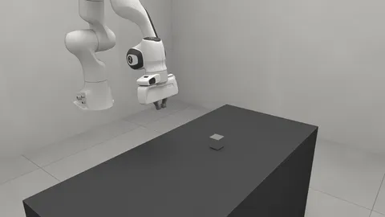
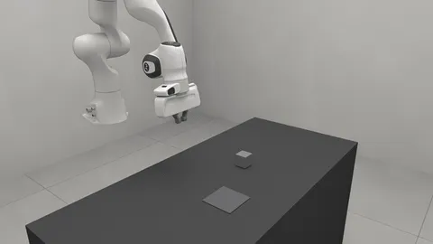
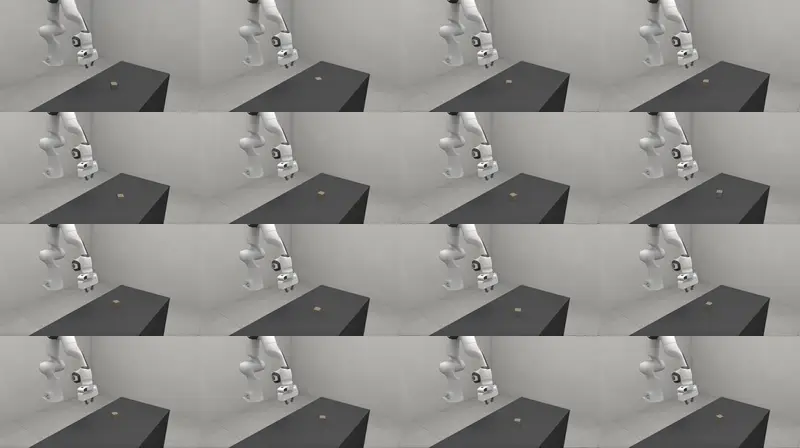

# Policies

A policy: a graph of tool calls and short Python scripts that
drives a task's robot, run by the [graph-as-policy](https://github.com/KeplerC/graph-as-policy)
runtime.

<!-- examples:start: written by scripts/example_readmes.py from each script's docstring -->

## Pick and place



A policy is a graph: a folder holding a `workflow.json` and the scripts it names.

`pick_place/` reads where the cube and the square are, works out four hand
poses in one script node, and moves the arm with `robot.*` tools. The task
names that folder in `(:graph pick "pick_place")`, and `SolutionGraph` runs
it for one episode, scored the way the benchmark scores every episode. Needs the `[gap]` extra.

**Key features:**

* a graph folder: tool nodes, a script node, and `$ref` from one node's output to another's input
* `(:artifacts (:graph LABEL "DIR"))`, resolved beside this script
* `robosimstudio_policy_agent.SolutionGraph` and `robosimstudio_bench.rollout`

```bash
uv run --extra gap examples/08_policies/00_pick_and_place.py
```

Source: [`00_pick_and_place.py`](00_pick_and_place.py)

## Check and retry


A graph can check its own work and branch: here, a missed grasp is tried once more.

`pick_place_retry/` splits the job into two subgraphs. `pick` turns the jaws
to close across the cube's faces, lifts, and raises if the hand shut on air; its
`on_error` names that outcome, and the top level routes it to a second copy of
`pick`. The cube starts somewhere new, turned, in each of four episodes. Needs the `[gap]` extra.

**Key features:**

* subgraphs, `on_error` outcomes and `conditional_edges` that route them
* a script node that calls a tool itself: `ctx.tool("robot.grasp_frame", ...)`
* `roll="held"`, so the wrist turns to the heading the graph asked for

```bash
uv run --extra gap examples/08_policies/01_check_and_retry.py
```

Source: [`01_check_and_retry.py`](01_check_and_retry.py)

## Without privilege



A graph that finds the cube and the target through a camera, as a real robot would.

With `privileged=False` no `sim.*` tool is registered: the graph has what a
real rig has, camera frames and the arm's own state. `pick_place_camera/`
reads the overhead depth image, takes what stands 50 mm above the bench as the
cube and what stands 4 mm above it as the pad, and runs the same pick, check
and place as the retry example. Needs the `[gap]` extra.

**Key features:**

* `SolutionGraph(..., privileged=False)`: no `sim.*` tool, only what a rig would have
* a camera rig the task names, rendered by `bench.Env(..., renderer="rtx")`
* a script node that back-projects a depth image into world points

```bash
uv run --extra gap examples/08_policies/02_without_privilege.py
```

Source: [`02_without_privilege.py`](02_without_privilege.py)

## Many worlds



A benchmark number is a success rate: run the same graph in many worlds at once.

A job names the task, the policy and how many episodes to run. With
`num_worlds=16` the fleet runner builds sixteen copies of the scene in one
model and steps them together, each world running its own episode of the
sampler and its own copy of the graph. It writes one results row per episode
and the rate with its 95% interval. Needs the `[gap]` extra.

**Key features:**

* `robosimstudio.specs.JobSpec`: task, policy, episodes, `num_worlds`
* the fleet runner, which batches the graph's motions across the worlds
* `robosimstudio_bench.wilson_interval` for the rate's uncertainty

```bash
uv run --extra gap examples/08_policies/03_many_worlds.py
```

Source: [`03_many_worlds.py`](03_many_worlds.py)

<!-- examples:end -->

## A graph is a folder

```
pick_place/
  workflow.json      # nodes, the edges between them, and subgraphs
  scripts/plan.py    # one script node: inputs in, a dict out
```

A task names the folder in `(:graph pick "pick_place")`, and
`SolutionGraph` runs it:

```python
import robosimstudio_bench as bench
from robosimstudio_policy_agent import SolutionGraph

env = bench.Env(task)
result = bench.rollout(env, SolutionGraph(env, graph="pick"))
print(result.success, result.steps)
```

The graph runtime is an extra: `uv run --extra gap <script>`.

## Nodes

| Node | What it does |
| --- | --- |
| `tool` | Calls one tool with its `inputs` |
| `script` | Runs `run(ctx, **inputs)` from a file under `scripts/`; `ctx.tool(name, ...)` calls a tool |
| `subgraph` | Runs a named subgraph; its `on_error` names the outcome when a node in it raises |
| `noop`, `end` | A named outcome, and the end of the graph |

`{"$ref": "plan.grasp"}` passes one node's output to another's input. A
subgraph ends at a `noop` whose name is its outcome, and `conditional_edges`
route outcomes: a missed grasp can go to a second copy of the pick.

## Tools

| Family | Tools |
| --- | --- |
| `robot.*` | `go_to_pose`, `move_to_joints`, `execute_trajectory`, `go_home`, `set_grip`, `open_gripper`, `close_gripper`, `get_gripper`, `get_ee_pose`, `get_observation`, `get_camera_pose`, `grasp_frame`, `describe_arm`, `describe_gripper`, `describe_workspace`, `wait_steps` |
| `motion.*` | `plan_linear`, `plan_joint`, `describe_planner`; with a collision-aware planner (`motion="curobo"`), also `plan_to_pose` and `solve_ik_batch` |
| `sim.*` | `get_object_pose`, `get_object_obb`, `get_region_obb`, `check_grasp`, `check_success`, `query` and more: the simulator's own answers |

## Privilege

`sim.*` tools are **privileged**: they answer from the simulator, which a real
robot cannot. `SolutionGraph(env, graph=..., privileged=False)` registers none
of them, so the graph has what a real rig has: camera frames, the arm's state,
the `robot.*` and `motion.*` verbs, and the perception tools (`geometry.*`,
`sam3.*`) that work from those frames. Build a graph with privilege, then take
it away and see what it still solves.

## Running graphs

| Where | How |
| --- | --- |
| A script | `bench.rollout(env, SolutionGraph(env, graph="pick"))` |
| The studio | `rss.view(env)`: the policy panel lists the task's graphs |
| A shell | `scripts/bench_run.py --solve graph --graph pick [--no-privileged]` |
| Many worlds | a `JobSpec` with `num_worlds=16`: one graph per world, motions batched |

A subgraph's `skill` may name a bundle in
[open-robot-skills](https://github.com/graph-robots/open-robot-skills). That
registry is optional: a `generic` subgraph needs none, and only a graph naming
a bundle needs the clone. Put it beside this checkout (`../open-robot-skills`,
the default in `pyproject.toml`'s `[tool.gap]`), or point `$GAP_SKILLS_PATH` or
`bench_run.py --skills` at it. The `sam3.*`
segmentation tool loads `facebook/sam3`, whose weights are gated on Hugging Face.


**See also:**

- `robosimstudio_policy_agent.SolutionGraph` and `robosimstudio_policy_agent.SolutionGraphBatched`
- [Tasks](../07_tasks/README.md) for what a graph is scored against
- [graph-as-policy](https://github.com/KeplerC/graph-as-policy) for the workflow format and the runtime
