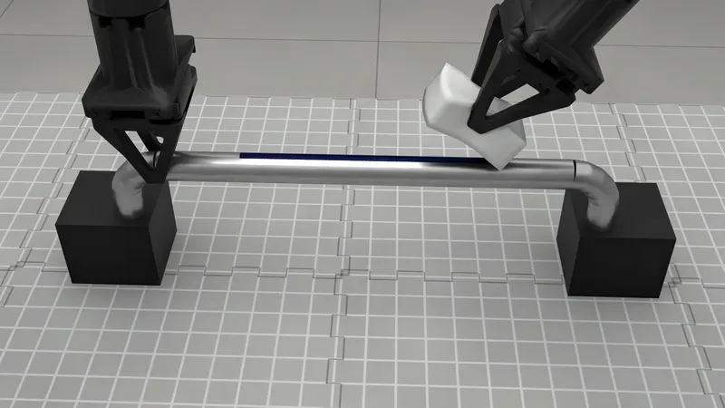

# Demos

The live demos from the project page, as scripts you run yourself: wipe a grab
bar with a sponge, route a cable into clips, and fold a towel. Each opens the
studio in your browser at `http://localhost:8080` with the robot already
holding the thing, and the hand follows the wrist gizmo as you drag it.

On the page:

- Drag the wrist gizmo to move the hand: the arm follows through IK, and what
  it holds comes with it.
- **Reset**, in the Simulation folder, puts the scene back where it started,
  the hold included. **Pause** and **Speed** sit beside it.

The wipe and the cable need the `[superdex]` extra, which installs on Python
3.12; the first run of each builds its environment and compiles its kernels, so
give it a minute. On a remote machine, forward the port
(`ssh -L 8080:localhost:8080 <machine>`) or see the studio's
[remote machines](../05_studio/README.md#remote-machines) section.

<!-- examples:start: written by scripts/example_readmes.py from each script's docstring -->

## Wipe the bar



Two YAMs and a sponge at a chrome grab bar: drag the right wrist gizmo down to press, and along the bar to wipe the marker off.

The twin of a real cell; its scene, every distance in it measured off the clip,
is `bar.py` beside this file. The sponge is foam that SuperDex steps, and the
blue stripe wears off where the foam presses and slides, read off the engine's
own contact samples. There is no pick: `take_hold` poses both hands by IK
where the sponge was built, closes them and settles, and the page shows the
press, its peak pressure and a contact map. Needs the `[superdex]` extra
(Python 3.12).

**Key features:**

* `rss.sponge` built where the hand will hold it, with `quat=` and `settle_frames=0`
* `rss.register_entity` for the welded bar and for a stripe that wears off
* `sim.arm(name).solve_q_full` and `sim.gripper(name)` to pose and close a hand before the page opens
* `page=` on `rss.view` for a reading of your own, and `studio.arms` to hand the arms over

```bash
uv run --extra superdex examples/09_demos/00_wipe_the_bar.py
```

Source: [`00_wipe_the_bar.py`](00_wipe_the_bar.py)

<!-- examples:end -->
