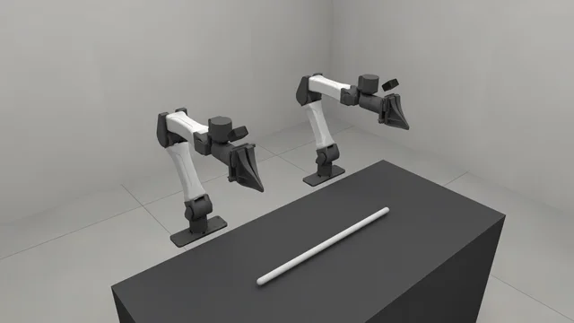
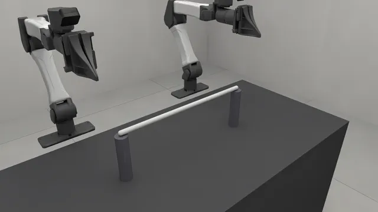
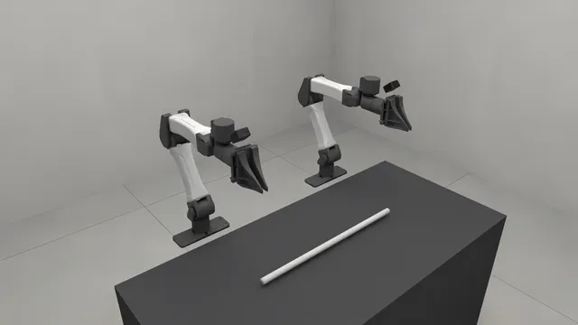

# Rope

Cables and ropes: a chain of capsules by default, or a Cosserat rod on
SuperDex with one line of physics. How a cable is built, part by part:
[`rod/`](rod/), the implementation `rss.rod` builds. The cable demo,
[route the cable](../09_demos/README.md#route-the-cable), is this kind under a
Panda.

<!-- examples:start: written by scripts/example_readmes.py from each script's docstring -->

## Drag a cable



A cable lying on the bench between two arms: click any segment and drag it, or close a gripper on it and lift.

A rope is a chain of short capsules on cable joints, and every capsule answers
a click on its own, so pulling it by an end and by its middle are two different
pulls. Take a handle on each end and `Move together` to carry it by both.
`at` places the cable's first end, not its middle.

**Key features:**

* `rss.rod` for a cable, a rope or a cord
* `rss.RodSpec`, what `rss.rod` returns, for its stiffness and friction
* `rss.robot` with `"yam_bimanual"` for two arms to pick it up with
* `rss.view` to drag it and drive the arms from the page

```bash
uv run examples/10_rope/00_cable.py
```

Source: [`00_cable.py`](00_cable.py)

## Cable between two posts



A cable clamped by both ends on top of two posts: hook it with a gripper or drag its middle, and it springs back.

`anchors` clamps a cable's ends to the world where they were built: the end's
position, its direction and its twist are held, so a cable clamped by one end
is a cantilever and by both a span that sags under its own weight. The posts
are scenery to rest the ends on, and the cable is built just clear of their
tops so that nothing pushes against a clamp.

**Key features:**

* `rss.rod` with `anchors=("start", "end")` to clamp both ends
* `rss.post` for something welded in place to string it between
* `rss.robot` with `"yam_bimanual"` for two arms to hook it with
* `rss.view` to pull the span and watch it recover

```bash
uv run examples/10_rope/01_between_posts.py
```

Source: [`01_between_posts.py`](01_between_posts.py)

## Cable on SuperDex



The same cable spec stepped by another engine: a Cosserat rod on SuperDex, beside arms that stay on MuJoCo.

One entry in the physics arrangement routes the `rod` kind to SuperDex, and
the cable stops being a chain of capsules: it becomes one centerline with a
twist at every node, and its matter is read as an elastic modulus rather than
as the capsule chain's stretch and bend stiffness. Newton still holds its
particles, so the page drags it the same way. Needs the `[superdex]` extra
(Python 3.12).

**Key features:**

* `rss.backend` with `"superdex"` to name the engine
* `rss.replace` on `rss.GENERIC` to route the `rod` kind to it
* `rss.RodSpec` with `young_modulus=`, the stiffness a Cosserat rod reads
* `sim.pipeline.program.summary()` to print which engine got what

```bash
uv run --extra superdex examples/10_rope/02_superdex.py
```

Source: [`02_superdex.py`](02_superdex.py)

<!-- examples:end -->
